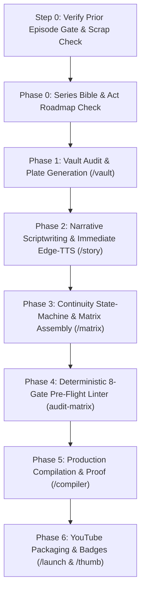

# 🚀 Manhwa New Episode Production Orchestrator (`/new-ep`)

> **Master SOP for Scaffolding & Orchestrating Episodic Pipelines**  
> **Slash Command:** `/new-ep`  
> **Workspace Root:** `quirky-chandrasekhar`

---

## 🎯 Mandatory Interactive Auto-Grill Pre-Flight (`ask_question`)

Whenever `/new-ep` is triggered, the agent MUST immediately halt and initiate an interactive `ask_question` interview:

```
[Interactive Pre-Flight Alignment Modal]
1. Target Franchise Selection:
   - (Recommended) Active franchise (e.g. Series 04: The Billion-Year Sovereign)
   - Other indexed studio franchises
2. New Episode Designation & Title:
   - Episode Number (e.g. EP02, EP03, EP04) and canonical subtitle from Series_Bible.md
3. Target Format Tier & Video Aspect Ratio:
   - Format 1: 9:16 Vertical Webtoon (1080x1920) for mobile-first webtoons
   - Format 2: 16:9 Horizontal Landscape (1920x1080) for widescreen sagas
```

---

## 🛑 The Production-First Episode Gate (Anti-Premature Expansion)
Strictly forbidden from suggesting, drafting, or initiating Episode 02 (or any subsequent episode) until:
1. Episode 01 (or previous episode) has 100% of its visual assets replaced from storyboard placeholders to finished high-fidelity panels.
2. The Studio Engine (Visual Bridge, Edge-TTS Sync, Subtitles, BGM Sidechain Ducking, and Master FFmpeg Compiler) is fully verified and operating with zero regressions.
3. The user explicitly reviews, signs off, and commands expansion to the next episode.

---

## 🔄 6-Phase Sequential Production Pipeline

The `/new-ep` orchestrator connects the studio's specialized skills in this non-negotiable order:



### Phase 0: The Master Series Bible Universal Grounding Invariant (100% Bible Sourcing)

The agent is **STRICTLY FORBIDDEN** from inventing, hallucinating, or extrapolating ungrounded plot points, environments, characters, or magical mechanics. 100% of episodic production MUST be sourced directly from the franchise's master ground truth: `00_Series_Bible_and_Character_DNA/Series_Bible.md`.

Prior to writing a single line of script or prompt, the agent MUST execute the **5-Point Bible Grounding Contract**:
1. **Plot & Multi-Episode Arc Architecture Anchor:** Cross-examine the target episode against the designated Multi-Episode Arc and Episode synopsis in `Series_Bible.md`. An Arc comprises 3–6 episodes (e.g. Season 1 = 18 episodes across 4 Arcs); never compress an Arc into 1–2 episodes. Verify the episode's exact position in the arc's setup, rising tension, midpoint turn, or climax.
2. **Spatial Environment & Architecture Anchor:** 100% of spatial enclosures must derive their architectural vocabulary, lighting, and layout directly from the World Overview in `Series_Bible.md`.
3. **Character Roster & Role Integrity:** Every character introduced or interacting must match the exact names, personalities, age progressions, and power tiers codified in the Bible and `character_vault/characters.json`.
4. **Weapons, Props & Relics Anchor:** All weapons and divine artifacts must be sourced directly from the Bible's Item registry.
5. **Magic System & Progression Arithmetic:** Magic tiers, vessel endurance equations, and resonance trials must strictly obey the mathematical and combat doctrines codified in `Series_Bible.md`.

### Phase 1: Character & Item Vault Audit (`/vault`) — Mandatory Pre-Script Gate
1. Scan the planned episode arc for any newly introduced characters, antagonists, bosses, or recurring weapons/props ($\ge 3$ scenes).
2. **Absolute Pre-Production Vault Lock:** Strictly forbidden from drafting scripts or prompt matrices until all new entities are:
   - Formally registered in `characters.json` or `items.json` with complete RPG stat baselines, visual appearance descriptions, and character DNA prompt anchors.
   - Explicitly mapped with their `episodes: ["EP01", "EP02"]` array so model counts remain 100% mathematically consistent across the Studio.
   - Textless master reference plates are generated matching the franchise format (9:16 Vertical or 16:9 Landscape) and saved in `character_vault/` (`{N}_{Role}_{Name}.jpg`) and mirrored into `00_Characters/`.
   - Native character token names registered as `@{Character Name}` with ZERO UUIDs.
3. Never map newly introduced characters to existing cast members or treat them as ambient backdrop silhouettes.
4. **Mandatory Family Member Pre-Registration:** Any family member (parents, siblings, children, grandparents, aunt, uncle) who appears in the narrative, shares meals, or interacts with the protagonist MUST be registered in `characters.json` with a dedicated reference plate. Generic anonymous family members are strictly forbidden.

### Phase 2: Narrative Scriptwriting & Immediate Edge-TTS Voiceover Synthesis (`/story`)
1. Scaffold `01_Episode_Script.md` following `/story` SOPs:
   - Strict linear chronological continuity (zero flash-forward cold opens).
   - Clean RPG arithmetic & vessel physical durability laws.
   - 5 Lore Auditor logic gates (credible motive, zero low-IQ civilizations).
   - Place precise clause-level `[IMG_XXX]` tags before every visual action.
2. **Immediate Edge-TTS Audio Synthesis (Real ffprobe Duration Mandate):**
   - The agent MUST trigger immediate voiceover audio synthesis upon concluding script drafting:
     ```powershell
     cd "C:\Users\MIchaelangelo\Documents\My Brand\02_Ventures & Digital Products\Manhwa Recap Studio\studio"
     node scripts/generate-tts.js <franchiseId> <episodeId> <voice>
     ```
   - This measures the exact `ffprobe` audio duration on disk, generates word-level `.srt`/`.vtt` subtitles, and writes `audio_telemetry.json` (`{ totalSeconds, formattedDuration, trackCount }`).
   - Completely eliminates fake "Runtime @ 140 WPM" estimates and prevents runtime mismatch surprises.
3. **Mandatory Episodic Shorts & Climax Tagging (Multi-Shorts Architecture):** Explicitly tag high-retention viral hook scenes directly in `01_Episode_Script.md`:
   - `<!-- CLIMAX_START -->` / `<!-- CLIMAX_END -->`: Peak climactic face-slap, boss cleave, or breakthrough (~45–56s).
   - `<!-- SHORT_EARLY_START -->` / `<!-- SHORT_EARLY_END -->`: Underdog humiliation-to-awakening or public appraisal shock (~45–55s).

### Phase 3: Continuity State-Machine & Visual Prompt Matrix Assembly (`/matrix`)
1. **Scene-by-Scene Continuity State-Machine Table:** Prior to matrix assembly, build a continuity tracking table:
   - Character Wardrobe: Locked across sequential scenes unless an explicit in-story change beat occurs.
   - Weapon/Prop Lifecycle: Equipped weapons persist in hands or sheaths until stowed, dropped, or shattered.
   - 2-Character Co-Presence: Both interacting characters must be co-anchored in `<character_refs>` and prompt body.
2. Partition scenes into dynamic 24-scene modular batches (`Batch 01` through `Batch K`).
3. Apply the 3-Tier Visual Engine (~70% Dual/Multi-Panel strips to ~30% Hero Plates).
4. Enforce the Anti-Bleed Rule: Zero spoken dialogue quotes (`"..."`) or narrator hyperbole dumped into visual prompts.
5. Export Google Flow XML decks with `filename="IMG_XXX.jpg"` attributes and pure `@{Character Name}` tokens.

### Phase 4: Deterministic 8-Gate Pre-Flight Linter Gate (`audit:matrix`)
1. Run the deterministic studio prompt matrix linter:
   ```powershell
   cd "C:\Users\MIchaelangelo\Documents\My Brand\02_Ventures & Digital Products\Manhwa Recap Studio\studio"
   node scripts/audit-matrix.js <franchiseId> <episodeId>
   ```
2. The linter strictly verifies:
   - Gate 1: 1:1 Scene Count & Tag Identity Sync (`[IMG_XXX]` == `<scene id="IMG_XXX">`).
   - Gate 2: 1:1 Narrative Clause Sync (`<narrative_sync>` lock).
   - Gate 3: Universal In-Prompt Entity Mirror & Zero Unbound Mentions Mandate (100% of referenced entities present in `<prompt>`, and all 13 vault entities mentioned in prompts wrapped in `@{Entity Name}` and bound in `<character_refs>`).
   - Gate 4: Dialogue & Sound Hyperbole Insulation (zero `"..."` quotes in prompts).
   - Gate 5: Temporal & Environmental Lighting Guard (zero daytime bleeds in night/indoor scenes).
   - Gate 6: Safe Anatomy & Anti-Deformation Positive Phrasing (zero `"all limbs connected"`).
   - Gate 7: Character Wardrobe & Continuity State-Machine Lock.
   - Gate 8: Dynamic Format Awareness (matches 9:16 or 16:9).
3. **Hard Blocker:** Exit Code MUST be 0 and score MUST be 100/100 before releasing batch XML chunks.

### Phase 5: Production Compilation & Proof (`/compiler`)
1. Compile batch preview MP4s and lossless master cut using real synthesized Edge-TTS audio.
2. Extract 2–4 video proof frames at flagged timestamps to visually audit subtitles against artwork.

### Phase 6: YouTube & Shorts Packaging Hub (`/launch` & `/thumb`)
1. Generate 5 High-CTR title archetypes ($\le 100$ characters).
2. Generate the 3 Master Thumbnail concepts with top-left yellow `1 - {N}` badge.
3. Output SEO description box with exact measured audio timestamps and pinned community comment.
4. TikTok & YouTube Shorts kit with continuous binge callouts and exact scene slice bounds.

---

## 🗡️ Weapon & Prop Pre-Flight Entity Extraction Gate
Prior to generating prompt matrices:
1. Scan the script for all combat weapons, tactical sensors, and colossal world artifacts.
2. Verify each item is extracted as an Entity with a generated master plate matching the franchise format in `character_vault/`.
3. Verify character and item tokens are formatted strictly with explicit curly brackets (`@{Character Name}`) in `characters.json` and `02_Prompt_Matrix.md`.
4. Execute the Metaphor De-Identification Gate: no figurative metaphors trigger false monster entity bindings.
5. Execute the Character Agency Gate: confirm scenes where antagonists act feature the antagonist, with ZERO default protagonist fallbacks.
6. Execute the Chronological Equipment Lifecycle Gate: confirm no weapons appear before their canonical debut scene.
