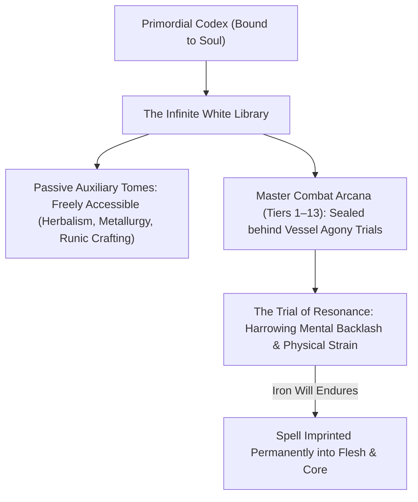
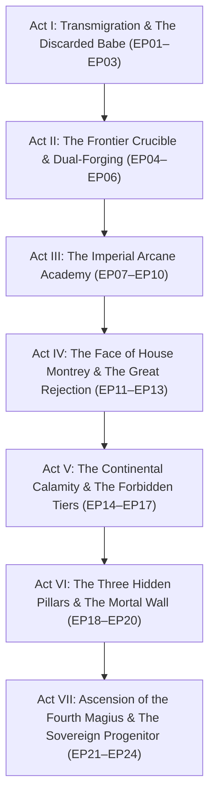

# 🎬 Series Bible: The Fourth Magius

> **Series ID:** `Series_05_The_Fourth_Magius`  
> **Canonical Title:** *The Fourth Magius: Rebirth of the Discarded Scion*  
> **Format:** 16:9 Full-Bleed Landscape (Widescreen Cinematic Composition)  
> **Video Format:** Format 2: 16:9 Landscape  
> **Narrative Archetype:** Dual-Discipline Sovereign (Arcane Spellcraft + Kinetic Mana-Forged Flesh)  
> **Studio Core Standard:** Manhwa Recap Studio 8 Core Pillars & 3-Tier Visual Engine  

---

## 🏛️ World Overview & Social Hierarchy

### 1. The Valerius Empire & The Arcane Caste
The series is set within the sprawling, semi-feudal **Valerius Empire**, a realm where political power, military commission, and social nobility are dictated strictly by the density and purity of an individual's innate mana vessels.
* **The Magic Nobility:** Families bearing ancient bloodlines command high-tier elemental lineages. In these households, children undergo a mandatory vessel examination at birth.
* **The Common Caste:** Individuals born with dormant or closed mana vessels are relegated to manual labour, low-ranking imperial infantry, or mercenary foot soldiers.
* **House Montrey:** One of the empire's five founding Archmage Houses, celebrated for their sapphire-crested ancestral towers and hereditary wind-lightning arcana. To House Montrey, a child born with closed mana vessels is considered an unpardonable blemish on the bloodline, deserving only immediate erasure or abandonment.

---

## ⚡ The 13-Tier Magic Hierarchy & The Legend of the Magius

Magic in this world is categorized across thirteen distinct thresholds. Each progression tier requires expanding the core mana reservoir and purifying the vessel's flow:

| Tier Range | Classification | Casting Mechanics | Tactical Output |
| :--- | :--- | :--- | :--- |
| **Tiers 1–3** | **Apprentice / Circle Novice** | External wooden staves, slow Latinate chanting, visible circle matrices. | Single-target firebolts, kinetic shields, localized breeze generation. |
| **Tiers 4–6** | **Adept / High Battle-Mage** | Silent casting, compressed elemental matrices, dual-cast affinities. | Wall-piercing lightning lances, subterranean stone spikes, flash freezing. |
| **Tiers 7–9** | **Grand Archmage** | Instantaneous chantless release, domain manipulation, spatial distortion. | Meteorological tempest control, city-block incineration, gravity inversion. |
| **Tiers 10–12** | **Continental Sovereign Mage** | World-resonant mana manipulation, elemental transmutation, void compression. | Tearing regional tectonic plates, continental barrier projection. Theoretical mortal ceiling. |
| **Tier 13** | **The Realm of the Magius** | Direct manipulation of primordial reality laws; independent from planetary mana currents. | Stabilizing dimensional boundaries, suppressing abyss rifts, god-tier conceptual sovereignty. |

### 🌌 The Three Hidden Pillars
In public imperial history, Tier 12 is universally regarded as the absolute pinnacle of human magic. Tier 13 is dismissed as an ancient myth. In reality, **three living Magius exist in deep seclusion**:
1. **The Magius of the Iron Boundary (Ignis):** Wanders the northern tectonic fracture, holding back volcanic abyss fissures.
2. **The Magius of the Endless Void (Aether):** Resides in the upper stratosphere, deflecting primordial dimensional meteors.
3. **The Magius of the Deep Roots (Terra):** Slumbers beneath the continental crust, regulating the world's planetary mana pulse.
* **The Destiny:** Michael Montrey is destined to awaken the long-lost divine authority, break the Tier 12 mortal barrier, and rise as the **Fourth Magius**—the only one in existence who bridges the divide between pure physical martial invulnerability and omnipotent cosmic magic.

---

## ⚔️ The Dual-Discipline Combat Doctrine: Mana-Forged Flesh

Standard magicians in this world suffer from a fatal physiological limitation: their bodies are fragile vessels. They rely entirely on external barrier spells. If a high-tier knight or stealth assassin closes the distance before a barrier is formed, even a Tier 7 Archmage can be slain by a common steel dagger. Conversely, knights possess dense physical bodies but lack the wide-area destructive output of high arcana.

### Michael's Breakthrough: Vessel Mana-Forging
Having reached Tier 10 in his previous world before exhausting his lifeforce against thousands of hunters, Michael possesses complete anatomical mastery of mana flow. Instead of storing mana merely inside an isolated abdominal core, Michael circulates liquid mana directly through:
1. **Skeletal Density:** Infusing mana into bone marrow, creating an unbreakable internal framework that easily withstands multi-ton kinetic impacts (Pillar 2: $Attack - Defence \le 0 \implies 0\text{ Dmg}$).
2. **Muscular Compression:** Contracting mana-saturated muscle fibers, delivering explosive, sound-barrier-breaking physical strikes without chanting.
3. **Cardiovascular Acceleration:** Circulating mana through the bloodstream, eliminating magical fatigue and allowing instantaneous spell transitions during close-quarters brawls.

---

## 📖 The Divine Artifact: The Primordial Codex & The White Library

The ancient grimoire that initiated Michael's transmigration is the **Primordial Codex of the First Magicians**. When Michael meditates or ascends a magic tier, his consciousness is drawn into the **White Dimension**—an infinite, pearlescent library containing millions of floating spellbooks left by ancient civilization sovereigns:

* **No Free Handouts (Anti-Slop Balance):** Low-tier auxiliary craft books (gathering, potion brewing, blacksmithing) are freely readable, allowing Michael to craft remedies and reinforce his equipment. However, high-tier combat spells are strictly locked behind **Resonance Trials**.
* **The Agony of Knowledge:** To imprint an ancient spell into his mind, Michael's consciousness must endure the raw, unbuffered memories of ancient apocalyptic clashes. His physical vessel experiences severe electrical mana strain. He must earn every single spell through unyielding willpower, ensuring viewers feel visceral respect for every upgrade.

---

## 🗺️ Master 7-Act Narrative Architecture (The Road to the 4th Magius)

> **The Golden Rule:** No need to rush. Worldbuilding is slow, progressive, and deeply textured. Every spell tier has tactile physical weight and clear mana arithmetic. Not everyone has magic talent; those without it become knights, craftsmen, or common mercenaries. In elite noble magician bloodlines, having closed mana vessels is considered an unforgivable defect, making an infant abandonable.

---

### 🏛️ Act I: Transmigration & The Discarded Babe (EP01 – EP03)
* **Core Theme:** Void Tear, Abandonment, Core Unsealing, and The White Library Foundations.
* **Target Runtime:** ~2.0 Hours (Tier 2/3 Cut)
* **Episodes:**
  * **EP01: The Last Archmage & The Discarded Babe**  
    *Past life climax:* Tier 10 Archmage Michael battles ten thousand inquisitors on Mount Calamity to protect the Primordial Codex. The Codex initiates a black hole void tear, carrying his soul across dimensions.  
    *Waking up:* Takes over the fragile body of 5-year-old orphan Michael Montrey, discarded in the freezing mud outside House Montrey's colossal gates because the brass diagnostic bell showed zero mana conductivity.  
    *Awakening:* Finds the physical Codex half-buried in the riverbank; resonance unseals his calcified vessels in agonizing liquid fire. Meets retired battle-mage Rowan Thorne and slays the Calamity Abyssal Wyrm with kinetic thunder.
  * **EP02: The Painless Crafts & The Agony of Magic**  
    *Worldbuilding:* Settling into the loft above Rowan's apothecary in Oakhaven. Michael explores the White Dimension—an infinite white library left by the First Magicians.  
    *System Balance:* Auxiliary craft tomes (botany, alchemy, runic engraving) are freely accessible with zero mental strain. However, high-tier combat spells require grueling **Resonance Trials** of mental and physical pain. Michael undergoes the harrowing trial for Tier 1 Master Thunder-Strike.
  * **EP03: The First Breakthrough & The Mercenary Crucible**  
    *Progression:* Reaching age eight. Michael achieves Tier 2 core saturation.  
    *Clash:* He registers as an independent mercenary scout to earn iron crowns; enters the local Iron-Rank dungeon and saves an arrogant squad of circle mages when their barriers collapse against stone-skinned trolls. Michael obliterates the troll with his bare, mana-reinforced knuckles.

---

### 🌲 Act II: The Frontier Crucible & Dual-Forging (EP04 – EP06)
* **Core Theme:** Physical-Mana Fusion Mastery, Ancient Ruins, and Regional Recognition.
* **Target Runtime:** ~2.5 Hours
* **Episodes:**
  * **EP04: The Kinetic Body & The Tier 3 White Trial**  
    *The Doctrine:* Traditional mages in the empire are fragile glass cannons; knights have no wide-area arcana. Michael masters *Mana-Forged Flesh*, weaving dense mana into his bone marrow and skeletal lattice ($Attack - Defence \le 0 \implies 0\text{ Dmg}$).  
    *The Trial:* He endures the Tier 3 White Dimension trial, experiencing the destruction of ancient cities to unlock spatial blinking and compressed kinetic shockwaves.
  * **EP05: The Blackwood Ruin Expeditions**  
    *Lore Discovery:* Michael explores an untamed pre-imperial ruin deep in the Blackwood Forest. He unearths ancient stone tablets revealing that the First Magicians were all dual-discipline battle-sages before the noble families corrupted the doctrine into stationary circle chanting.
  * **EP06: The Beast Tide & The Imperial Watch Cordon**  
    *Climax:* A massive Tier 5 rift beast horde attacks Oakhaven. Imperial garrison mages panic as their spell barriers shatter. Michael steps into the breach with his blackwood staff, cleaving the Alpha Behemoth in two. Imperial Watch scouts witness the impossible boy and send encrypted reports to the capital.

---

### 🎓 Act III: The Imperial Arcane Academy (EP07 – EP10)
* **Core Theme:** Institutional Arrogance, Knights vs Magicians, Strategic Sandbagging.
* **Target Runtime:** ~3.0 Hours
* **Episodes:**
  * **EP07: The Road to the Capital & The Entrance Exam**  
    *Journey:* Age thirteen. Michael travels to the imperial capital of Valerius. He enrolls in the Imperial Arcane Academy entrance trials as an unaffiliated commoner orphan.  
    *Strategic Sandbagging:* Rather than exposing his god-tier abilities, Michael intentionally limits his output, scoring in the exact middle percentile to blend in while observing imperial power structures.
  * **EP08: The Fragile Circles & The Knight Sparring**  
    *Collegiate Life:* Arrogant noble students boast about their bloodlines and expensive staves. During a joint training session between the Magic Academy and the Imperial Knight Cadets, high-born mages are easily disarmed. Michael enters the arena bare-handed, catching an enchanted steel broadsword between two fingers and shocking the veteran instructors.
  * **EP09: The Tier 6 White Library Trial & The Glacial Domain**  
    *The Trial:* Midnight meditation inside the White Dimension. Michael faces the brutal mental trial of the ancient *Absolute Zero Glacial Domain*, enduring frostbite of the soul to master chantless instant-freeze matrices.
  * **EP10: The Ancient Labyrinth Tournament**  
    *The Crucible:* The annual Imperial Labyrinth Tournament across fifty underground dungeon floors. Noble factions conspire to eliminate the commoner anomaly. Michael navigates the traps with ease, protects his commoner teammates, and shatters the 50th-floor boss solo, setting a record unseen in two centuries.

---

### 🔥 Act IV: The Face of House Montrey & The Great Rejection (EP11 – EP13)
* **Core Theme:** Biological Family Confrontation, Hypocrisy, and The Sovereign Progenitor.
* **Target Runtime:** ~2.5 Hours
* **Episodes:**
  * **EP11: The Resonance Mirror & The Patriarch's Panic**  
    *The Revelation:* Patriarch Valerius Montrey and Head Elder Cassius examine the Labyrinth surveillance mana signatures. The resonance wavelength is a 100% biological match to the infant they discarded thirteen years ago. The realization that the empire's greatest rising prodigy was their own "defective" son sends shockwaves through the family.
  * **EP12: The Velvet Carriage & The False Reconciliation**  
    *The Temptation:* House Montrey sends gilded carriages, chests of platinum crowns, and an imperial petition to officially reinstate Michael as First Heir. Patriarch Valerius invites Michael to an opulent family banquet, attempting to use paternal guilt, noble prestige, and emotional manipulation to bring Michael under his control.
  * **EP13: The Burning of the Dragon Crest (Peak Face-Slap)**  
    *The Confrontation:* In front of the assembled Montrey nobility and imperial dignitaries, Michael stands tall and unbothered. He calmly recites the exact words Valerius spoke when abandoning him: *"House Montrey does not raise parasites."*  
    *The Climax:* Michael pulls out the Montrey platinum crest amulet, crushes it into metal dust in his bare fist, and incinerates the adoption scroll with cyan lightning. He proclaims:  
    > *"You did not discard a defect. You threw away your house's only hope. I have no need for your dying name—I am the progenitor of my own sovereign lineage."*

---

### ⚔️ Act V: The Continental Calamity & The Forbidden Tiers (EP14 – EP17)
* **Core Theme:** Continental Warfare, Tiers 7–10 Mastery, and the Collapse of Mortal Magic.
* **Target Runtime:** ~3.5 Hours
* **Episodes:**
  * **EP14: The Great Continental Incursion**  
    *Crisis:* Neighboring dark magocracies and abyssal cults launch a surprise assault on the empire. The Montrey family's northern defense line collapses due to rigid circle-chanting vulnerabilities. Michael is granted independent sovereign command of the frontier legion.
  * **EP15: The Battle of the Red Plains (Tier 8 & 9 Unleashed)**  
    *Warfare:* Michael leads commoner knights and battle-mages into battle. He unleashes the *Heavenly Constellation Storm Array* across twenty miles of battlefield while physically decimating enemy war golems with sound-barrier kinetic strikes.
  * **EP16: Reclaiming Tier 10: The Apex Ceiling**  
    *Ascension:* Michael breaks through to Tier 10—the pinnacle of his past life. He unlocks the inner sanctum of the White Library, where the ancient Codex reveals the cosmic truth: the continental dimensional seals are disintegrating, and mortal Tier 12 magic is mathematically insufficient to stop the apocalypse.
  * **EP17: The Downfall of Patriarch Valerius**  
    *Karma:* Desperate to regain family standing, Valerius attempts a forbidden blood ritual to force a breakthrough, causing a catastrophic mana implosion in the capital. Michael neutralizes the fallout, saving thousands of innocent citizens while leaving Valerius permanently stripped of his core—a helpless mortal dependent on the world he once looked down upon.

---

### 🌌 Act VI: The Three Hidden Pillars & The Magius Threshold (EP18 – EP20)
* **Core Theme:** Meeting the Living Legends, The Fatal Flaw of History, Tier 12 Mastery.
* **Target Runtime:** ~3.0 Hours
* **Episodes:**
  * **EP18: The Summit of the Three Pillars**  
    *Myth Becomes Reality:* Michael is invited to the celestial boundary by the **Three Living Magius**:  
    1. *Ignis of the Iron Boundary* (Northern Tectonic Guard)  
    2. *Aether of the Endless Void* (Stratospheric Meteor Sentinel)  
    3. *Terra of the Deep Roots* (Continental Planetary Regulator)  
    They reveal that Tier 13 is real, but no mortal has ascended in ten thousand years.
  * **EP19: The Fatal Flaw: The Shattered Vessels**  
    *The Revelation:* The Three Magius explain why hundreds of legendary Tier 12 archmages failed and died trying to become the 4th Magius: their mortal physical bodies could not contain Tier 13 cosmic mana and exploded. Michael’s *Mana-Forged Flesh* (bone marrow density and reinforced cellular tissue) is the literal evolutionary missing link that humanity lacked.
  * **EP20: The Final Trial of the White Dimension**  
    *The Ultimate Agony:* Michael enters the deepest, pearlescent core of the Primordial Codex. He faces the collective consciousness of all First Magicians, enduring the total cellular deconstruction and divine reconstruction of his vessel across forty-eight hours of pure soul agony.

---

### 👑 Act VII: Ascension of the Fourth Magius & The Sovereign Progenitor (EP21 – EP24)
* **Core Theme:** The Primordial Abyss Convergence, Ascending to Tier 13, The Eternal Dynasty.
* **Target Runtime:** ~3.5 Hours
* **Episodes:**
  * **EP21: The Rupture of the Dimensional Boundary**  
    *The Cataclysm:* A world-ending Void Devourer tears through the planetary crust. The Three Ancient Magius deploy their absolute domains, but their bodies begin to burn out under the apocalyptic pressure. The empire faces total annihilation.
  * **EP22: The Birth of the Fourth Magius**  
    *Ascension:* Michael breaks through the mortal Tier 12 ceiling! The sky turns brilliant celestial sapphire as Tier 13 Magius authority manifests around him. Combining boundless primordial cosmic arcana with invulnerable kinetic flesh, Michael charges the Void Devourer in full-bleed 16:9 widescreen spectacle.
  * **EP23: The Great Sealing & The Bow of the Pillars**  
    *The Triumph:* Michael delivers a continent-shattering physical-arcane strike directly into the beast's core, obliterating the entity and permanently sealing the dimensional breach. The Three Ancient Magius kneel in profound respect, acknowledging Michael as the **Fourth Magius—and the undisputed strongest among them all**.
  * **EP24: The Sovereign Progenitor (Grand Finale)**  
    *The New World:* Michael establishes the **Sovereign City of Montrey-Aethel**, founding a new academy where magic and martial cultivation are taught as one united discipline. The disgraced remnants of House Montrey live as humble commoners under his protection. Michael sits upon the sovereign throne with Elder Rowan, his loyal allies, and the Primordial Codex by his side—the eternal progenitor of a new golden era.

