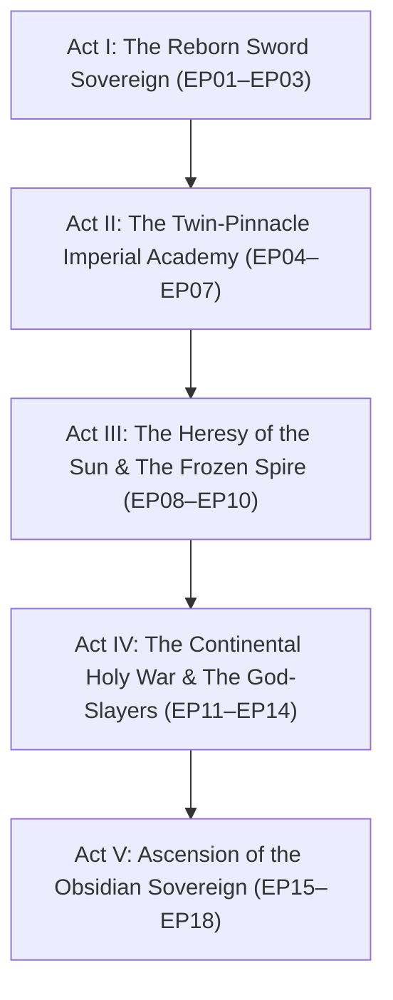

# 🎬 Series Bible: The Obsidian Spellsword

> **[PRE-EPISODE VAULT GATES RESOLVED — `EP04`+ READY FOR V2.0 PIPELINE]**  
> `character_vault/flow_entities.json` is now populated (`19` pure-name vaulted entities) and the duplicate `aiden_drake` / `aiden_drake_past_life` binding on `00_Prologue_Aiden_Drake.jpg` has been consolidated into canonical `aiden_drake` (`audit-vault.js` Exit Code `0`).  
> *Note:* Historical `EP01–EP03` prompt-matrix defects documented in [`PRE_NEXT_EPISODE_FIX_NOTES.md`](file:///C:/Users/MIchaelangelo/Documents/My%20Brand/02_Ventures%20&%20Digital%20Products/Manhwa%20Recap%20Studio/01_Franchises/Series_07_The_Obsidian_Spellsword/00_Series_Bible_and_Character_DNA/PRE_NEXT_EPISODE_FIX_NOTES.md) (`<action_layer>` tokenization, braced `<item_refs>`, `G07`/`G10`/`G31`/`G35`/`G38`/`G39`) remain optional if not recompiling Act I, but **must not** carry into `EP04`+ (enforce strict V2.0 pipeline + 100/100 across all 43 gates).

> **Series ID:** `Series_07_The_Obsidian_Spellsword`  
> **Canonical Title:** *The Obsidian Spellsword: Reborn to Sever the Gods*  
> **Format:** 16:9 Full-Bleed Landscape (Widescreen Cinematic Composition)  
> **Video Format:** Format 2: 16:9 Landscape  
> **Narrative Archetype:** Reincarnated Founder • High-Noble Dual Sovereign (Sword & Magic) • Anti-Divine Retribution  
> **Studio Core Standard:** Manhwa Recap Studio 8 Core Pillars, Dynamic Pulse Pacing & Class-Combat Archetype Integrity  

---

## 🏛️ World Overview & Social Hierarchy

### 1. The Aurelian Empire & The Twin-Crest Aristocracy
The series is set within the sprawling, prestigious **Aurelian Empire**, a civilization where noble status is commanded through martial swordcraft and elemental sorcery.
* **The High Aristocracy:** Imperial ducal houses hold vast private territories, private knight orders, and expansive libraries. Among them, **House Vaelgard** stands supreme as the Founding Pillar of the Imperial Vanguard.
* **The Ancient Precedent:** 1,000 years ago, the legendary mortal sword saint **Aiden Drake** reached the pinnacle of swordsmanship. Lacking a magic root, he unlocked the underlying secrets of mana threads through pure study, mentoring the greatest wizards of his era before being assassinated by the Gods right at the threshold of Godhood.
* **The Modern Rebirth:** Reborn 1,000 years later as **Julian Vaelgard** (Age 15), the youngest son of the Duke of Vaelgard. The original 15-year-old Julian was frail and assassinated by hidden imperial traitors using the legendary God-Weeping Root—the exact celestial poison used on Aiden Drake 1,000 years ago. Aiden's reincarnating soul fuses into the dying vessel, ignites the God-Severing Eye, and severs the toxic mana threads from within to revive the body! He discovers his modern ducal family was founded by his own sworn brother in his honour!

---

## ⚡ The Dual-Rank Power System & The Mana Thread Law

Combat and progression in this world are divided into clean, structured tiers:

### 1. Swordsmanship Ranks (Bronze to Obsidian)
1. **Bronze Rank:** Honed physical edge, basic aura reinforcement, cutting through raw iron and timber.
2. **Silver Rank:** Flowing silver blade aura, crescent shockwaves, slicing stone and enchanted steel.
3. **Gold Rank:** Radiant golden aura velocity, sound-barrier blade thrusts, shattering standard defensive barriers.
4. **Platinum Rank:** Dense, compressed aura blades, siege-level cleaves capable of splitting fortifications.
5. **Diamond Rank:** Crystalline aura intent that cuts without physical blade contact, splitting ravines and dragon hide.
6. **Obsidian Rank:** The legendary, pitch-black void aura—the absolute mortal pinnacle where sword intent cuts through space, magic domains, and divine law itself.

### 2. Magic Ranks (1-Star to 6-Star)
1. **1-Star (Novice):** Basic sparks, minor breeze, localized water droplets, single-target magic missiles.
2. **2-Star (Adept):** Projectile elemental matrices (Fireball, Wind Cutter, Stone Wall, Lightning Spark).
3. **3-Star (Mage):** Chantless elemental constructs, Area-of-Effect blasts, elemental weapon coating.
4. **4-Star (High Battle-Mage):** Dual-element fusion, localized meteorological control, wall-cleaving elemental beams.
5. **5-Star (Archmage):** Cataclysmic elemental domains, continental summons, instantaneous short-range blink.
6. **6-Star (Sovereign Archmage):** Reality-bending elemental mastery, immortal soul preservation, planetary pulse resonance.

### 3. The Reborn Gift: The "Mana Thread" Severing Eye
Because Aiden was murdered by divine sorcery at the gates of Godhood, his reincarnated soul rejects the authority of magic itself.
* **The Visual Manifestation:** Julian's eyes gleam with a subtle silver hue, allowing him to perceive the literal glowing **"Mana Threads"** holding every spell matrix, barrier, and enchantment together.
* **Surgical Dissipation (*Snip*):** By severing the central "Anchor Thread" with his sword edge, hostile spells instantly unravel like loose yarn into harmless sparks—completely bypassing brute-force clashes.
* **Progression of the Thread-Cut:**
  - *Bronze Null:* Slices single-strand 1-Star spells (popping firebolts like soap bubbles).
  - *Silver Null:* Slices multi-strand 2-Star matrices and reflects the unraveled energy back at the caster.
  - *Gold Null (Thread-Eater):* Absorbs the severed mana into his own core, rapidly recharging his own spells.
  - *Platinum Null:* Radiates a 10-meter anti-magic field that destabilizes enemy chantless casting.
  - *Diamond Null:* Slices ancient sealing curses, spatial barriers, and 5-Star cataclysmic domains.
  - *Obsidian Null (God-Severing):* Slices through divine immortality, celestial halos, and holy decrees.

---

## 🏰 Canonical World Setting: The Grand Ducal Seat of House Vaelgard
* **Location & Lore Identity:** The ancestral seat of Grand Duchy Vaelgard in the Aurelian Empire.
* **Canonical Reference Plates:**
  * Exterior Establishing: `00_World_Setting_Canonical.jpg` (Palace Exterior with fifty-foot Obsidian Sword Saint statue)
  * Interior Sanctuary: `01_Ancestral_Vault_Library.jpg` (Grand Rotunda Library with Aiden Drake's gilded diary)
  * Martial Ground: `02_Obsidian_Sparring_Arena.jpg` (Runic training colosseum with wisteria colonnades)
* **Visual DNA:** Pristine white marble, silver granite spires, sapphire blue roofs, clear cobalt-blue daylight sky, cascading crystal water canals, and glowing cyan/golden mana motes. Textless 16:9 full-bleed manhwa artwork.

---

## 🗺️ Master Multi-Episode Arc Roadmap

### Act I: The Reborn Sword Sovereign (EP01 – EP03)
* **EP01: The Poisoned God & The 1,000-Year Rebirth**  
  *Prologue:* Aiden Drake assassinated at the threshold of Godhood by celestial poison.  
  *The Rebirth:* Waking up 1,000 years later as 15-year-old Julian Vaelgard in the lap of luxury after severing the celestial poison that murdered his vessel. Discovering his family was founded by his own brother in his honour!  
  *The First Test:* Picking up a custom silver training rapier, seeing the mana thread on a practice dummy, and cleanly snipping it with a wooden stick, leaving Instructor Kael dumbfounded.
* **EP02: The Ancestral Vault & The First True Spell**  
  *The Library:* Julian explores the ancestral vault, finding his old personal diary worshipped as the sacred *Principles of Mana Weaving*.  
  *Dual Mastery:* Unlocking his new magic root, casting a chantless 2-Star *Gale Blade* wrapped around his silver sword. Duke Gerald showers his prodigy son with rare beast ores and private training time.
* **EP03: The Holy Inquisitor & The Severed Blessing**  
  *The Intrigue:* Inquisitor Malakor arrives from the Church of the Radiant Dawn to inspect the ducal heirs.  
  *The Conflict:* Malakor attempts to place a covert "Divine Geas" on Julian under the guise of a baptismal blessing. Julian's silver eyes narrow; he snips the divine thread, causing the sacred chalice to shatter in Malakor's hands and igniting a silent war with the Church.

### Act II: The Twin-Pinnacle Imperial Academy (EP04 – EP07)
* **Minimalist Vault Scope (Zero New Props, Zero Dummies):**
  * *Locations (4):* `Imperial Academy Grand Courtyard` (`imperial_academy_courtyard`), `Academy Dueling Amphitheater` (`academy_dueling_amphitheater`), `Academy Assessment Ward Grounds` (`academy_assessment_ward_grounds`, night-moonlit ward terrace & upper spire added `EP05`+), `Frozen Spire Sanctum` (`frozen_spire_sanctum`, subterranean hidden seal chamber beneath the Frozen Spire added `EP07`).
  * *Characters (5):* `@{Julian Vaelgard (Academy Uniform)}`, `@{Dean Alistair Vance}` (5-Star Archmage & Academy Dean), `@{Lord Cassian Thorne}` (Church-aligned Gold-Rank / 3-Star noble rival; defeated & concluded in `EP06`), `@{Archmage Lyra}` (6-Star Frozen Star watching from the upper spire), and `@{Church Saboteur Envoy}` (covert Church handler tainting assessment wards in `EP05`+).
  * *Weapons / Relics:* `@{Vaelgard Silver Training Rapier}`, `@{Obsidian Greatsword}` (`EP07` Frozen Spire seal reveal), and illicit `@{Radiant Crimson Core Vial}` (`EP06`). Zero practice dummies.
* **EP04: The Twin-Pinnacle Gates & The Unbroken Stance**  
  *Arrival & Provocation:* Julian enters the Twin-Pinnacle Imperial Academy; Church-aligned rival Lord Cassian Thorne publicly mocks House Vaelgard in the Grand Courtyard.  
  *Live Entrance Trial:* Dean Alistair Vance orders an immediate live Dual-Threshold Duel in the Amphitheater. Armed only with his silver rapier, Julian snips Cassian's 3-Star *Crimson Lance* mid-flight and defeats him in three clean exchanges.
* **EP05: The Midnight Sabotage & The Frozen Star's Gaze**  
  *Conspiracy:* Humiliated, Cassian's Church handlers covertly taint the Academy's formation wards to trigger a lethal mana backlash during the First-Year Assessment.  
  *Intervention:* Julian's God-Severing Eye detects and severs the corrupted divine threads in real time, saving the cadets and catching a fleeting glimpse of Archmage Lyra watching from the upper spire.
* **EP06: The Crowned Duel & The Thread-Eater Awakening**  
  *Escalation:* In the Academy Ranking Finals, Cassian forces 4-Star dual-element output using illicit Church enhancement.  
  *Climax:* Julian's eye evolves to **Gold Null (Thread-Eater)**, absorbing Cassian's severed 4-Star matrix into his own core to unleash a chantless *Obsidian Gale* and claim Rank 1.
* **EP07: The Heresy Summons & The Frozen Spire**  
  *Fallout:* Church envoys arrive at the Academy gates to arrest Julian for void heresy after witnessing Thread-Eater.  
  *Act II Finale:* Dean Vance invokes Imperial Neutrality to block the Church and reveals Aiden Drake's hidden seal beneath the Frozen Spire, while Archmage Lyra steps from the shadows to kneel before her reborn master.

---

## ⚖️ Act II+ Pacing & Prop Minimization Law (`EP04`+)

To eliminate Act I visual consistency drift and static training filler, **all episodes from `EP04` onward** MUST enforce these three hard production constraints:
1. **Zero Practice Dummies & Zero Sparring-Arena Loops:** Strictly **ban** training dummies (`@{Enchanted Iron-Wood Practice Dummy}` or any practice targets/mannequins) and repetitive `@{Private Obsidian Sparring Arena}` recap/warm-up loops. Replace dummy demonstrations with **live duels, academy trials, and active political/combat confrontations**.
2. **Prop & Weapon Minimization:** Restrict physical props and weapons strictly to essential signature items (`@{Obsidian Greatsword}`, `@{Vaelgard Silver Training Rapier}`, and `@{Principles of Mana Weaving}` when plot-active). **Avoid** minor props (`@{Wooden Practice Rod}`, `@{White Marble Meditation Bench}`, chalices, or miscellaneous scrolls) unless plot-critical across `>= 2` scenes, preventing generative reference drift and prop-flicker defects.
3. **Dynamic Narrative Pacing (`~45–50` Words/Scene):** Target `~45–50` words per scene (`~25–30` minutes runtime per episode) driven by crisp dramatic escalation, tactical sword-and-spell choreography, and live stakes rather than solitary practice demos.

---

## 🎨 Studio & Google Flow Master Directives (SSOT)

<!-- STUDIO_BIBLE_DIRECTIVES_START
{
  "styleName": "The Obsidian Spellsword (High-Prestige Aristocratic Empire)",
  "format": "16:9",
  "voiceId": "en-GB-RyanNeural",
  "genreRule": "High fantasy action manhwa webtoon art style, sharp black ink linework, clean crisp illumination, vibrant high-contrast cel shading, textless 16:9 horizontal widescreen landscape aspect ratio (1920x1080 horizontal full bleed). The Grand Ducal Realm of House Vaelgard: an elegant, pristine aristocratic high-magic medieval palace built of polished white marble and silver granite, crowned with sapphire blue roofs and golden trim. Expansive polished stone courtyards flanked by cascading crystal-clear aqueduct fountains, manicured emerald gardens, fifty-foot ancient obsidian sword saint monument, glowing floating mana lanterns, and runic obsidian sparring arenas.",
  "forbiddenRule": "STRICTLY FORBIDDEN STYLE DRIFT: Never generate modern streetwear, modern haircuts, hoodies, sneakers, backpacks, asphalt roads, cars, contemporary cityscapes, or laboratory science equipment. Never use clinical physics jargon ('kinetic', 'vectors', 'telemetry', 'cellular lattice'). All characters must strictly wear period-accurate high-noble medieval fantasy attire (silk doublets, velvet mantles, silver-steel plate armor, tailored cravats, fine dueling leathers).",
  "crowdRule": "Background noble attendants, knights, and court scholars in soft depth-of-field blur permitted ONLY in public courtyards and exhibition banquets. In private study rotundas and master bedrooms, enforce strict isolation with zero extraneous background characters.",
  "defaultVaultDna": "high fantasy action manhwa art style, sharp black ink linework, clean crisp illumination, vibrant cel shading, high-noble medieval fantasy attire, textless artwork",
  "exampleEntities": [
    "@{Julian Vaelgard}",
    "@{Duke Gerald Vaelgard}",
    "@{Duchess Eleanor Vaelgard}",
    "@{Archmage Lyra}",
    "@{Master Swordsman Kael}",
    "@{High Inquisitor Malakor}",
    "@{Vaelgard Silver Training Rapier}",
    "@{Principles of Mana Weaving}",
    "@{Aiden Drake}",
    "@{Obsidian Greatsword}"
  ],
  "vocabulary": {
    "diegeticScrolls": "ancient illuminated manuscripts/ancestral tomes/spell scrolls",
    "diegeticSignage": "carved ducal armorial crests/guild plaques",
    "diegeticSteles": "ancient runic steles/obsidian monolith monuments",
    "diegeticUi": "glowing silver-and-azure arcane rings/mana thread matrices"
  },
  "spatialEnclosures": {
    "vaelgard_palace_exterior": "Grand ancestral palace of House Vaelgard built from pristine white marble and silver granite, sapphire roofs, cascading water aqueducts, and a colossal obsidian sword saint statue.",
    "ancestral_vault_rotunda": "Soaring multi-tiered circular arcane library rotunda with five-story mahogany bookshelves, stained-glass dome window, and floating golden mana lanterns.",
    "obsidian_sparring_arena": "Vast circular outdoor sparring colosseum paved with dark obsidian flagstones carved with glowing cyan runes, surrounded by white marble colonnades and purple wisteria vines.",
    "imperial_academy_courtyard": "Soaring ivory-and-sapphire gothic academy plaza with twin obsidian-and-gold sword-and-magic triumphal archways, manicured emerald lawns, and clear cobalt daylight sky.",
    "academy_dueling_amphitheater": "Sunken tiered white-marble dueling colosseum inscribed with glowing azure boundary runes, flanked by elevated noble viewing galleries under an open daylight sky."
  }
}
STUDIO_BIBLE_DIRECTIVES_END -->
