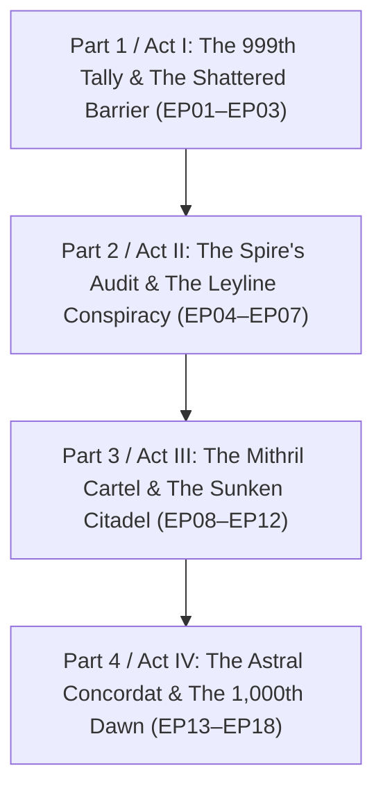

# 🎬 Series Bible: My Cursed Iron Sword Kept Every Spell That Killed Me Across 999 Regressions

> **[PLANNING PHASE DATA ONLY — AWAITING OPERATOR REVIEW & WORLD SETTING VISUAL GATE]**  
> This Series Bible locks the world architecture, grounded math, causal lore, entity roster, and Discrete Act roadmap for `series_08`.  
> **Pending Next Gate:** Operator sign-off on Planning Data before running `World Setting Visual Selection Gate`, populating `character_vault/` reference plates, or scaffolding `EP01/`.

> **Series ID:** `Series_08_Cursed_Iron_Sword_999_Regressions`  
> **Franchise Code:** `FRAN-CIS-008` (`id: "series_08"`)  
> **Canonical Title:** *My Cursed Iron Sword Kept Every Spell That Killed Me Across 999 Regressions*  
> **Format:** 16:9 Full-Bleed Landscape (`1920x1080`)  
> **Release Cadence:** Discrete Act / Part Model (`(Part 1)`..`(Complete)`) — Each Act compiled as a `>= 60`-minute feature  
> **Narrative Archetype:** 999-Regression Tactical Swordsman • Open-Power Soul-Echo Arsenal • Grounded Medieval Sword & Magic  
> **Studio Core Standard:** `00_Engine/05_Universal_Arithmetic_and_Economy_Codex.md`, Open-Power Invariant, Smart/Reactive MC, Solo Grinding Bias, Zero Causal Skips, Normal-IQ World Logic

---

## 🏛️ 1. World Overview, Political Leverage & Zero Causal Skips

### 1. The Kingdom of Valenreach & Institutional Power Roots
The story unfolds in **Valenreach**, a heavily fortified medieval magic-and-steel kingdom bordering the Ashen Dimensional Rifts. Authority is split between the Crown, the **Royal Sword & Magic Academy**, the **Imperial Archmage Spire**, and four High Ducal Houses—none of which hold arbitrary or unexplained power:

* **Why the Royal Academy Holds Grand Barriers & Appraisal Obelisks:** Three centuries ago during the First Abyssal War, Valenreach's founders excavated three subterranean **Leyline Anchor Cores** beneath the capital plateau. The Royal Academy sits directly atop the primary junction. Funded by an annual `2,500 gp` Crown defense tithe, the Academy's sunken amphitheater barrier routes incoming Tier 1–5 spell force down brass grounding pylons into bedrock reservoirs. It is an engineered arcane grid with measurable thermal load limits—meaning concentrated resonance overload *can* fracture it.
* **Why Grand Imperial Archmage Vaelen Thorne Rules the Spire:** Vaelen Thorne is not untouchable by author fiat; his house forged the **Astral Concordat**, granting the Spire a Crown-sanctioned monopoly over deep-earth Mithril-Mana mining (`12,000 gp/year` state revenue). That wealth funds Spire relay towers, private battle-mage retainers, and soul-bound royal succession contracts. His signature Tier-8 forbidden spell, *Astral Judgment*, requires a 45-second triple-circle alignment locked to Spire relay beacons—devastating when uncontested, but interruptible if its relay geometry is disrupted.
* **Why House Ashveil Commands High-Tier Relics (Lady Seraphina Ashveil):** Damon's former Timeline-1 fiancée did not stumble into a Tier-6 *Crimson Meteor* scroll-ring by luck. House Ashveil guards the western rift frontier; Grand Archmage Vaelen gifted Seraphina the bound Tier-6 signet ring as a political dowry to secure Ashveil's border garrison votes against the Crown Regent.

### 2. Normal-IQ World Logic (~70% Smart/Calculating, ~30% Plausible Overconfidence)
* **70% Calculating Professionals:** Academy examiners inspect mana wavelengths, log duel telemetry, check for banned external catalysts, and reposition formation guards when unexpected variables appear. Noble rivals like **Lord Cassian Thorne** deploy layered ward-stones, anti-projectile screens, and flanking footwork rather than charging blindly.
* **30% Plausible Overconfidence:** Antagonists underestimate Damon for concrete, rational reasons—trusting calibrated royal appraisal hardware, seeing battered `45 sp` leather armor and a common-looking rusted broadsword, and knowing a Squire-class cadet cannot sustain Tier-6 mana draw from an Lv 8 human core. Zero cartoonishly brain-dead mobs.

---

## ⚔️ 2. Protagonist Invariants & Exact Regression Sword Mechanics

### 1. Protagonist Profile: Damon Cross (Age 17, Regression #1000)
* **Visual Anchor:** 17-year-old squire in battered charcoal leather armor over a dark slate linen tunic, faint pale scar across his left eyebrow, sharp reactive amber-steel eyes, gripping his notched, rust-black iron broadsword etched with 999 microscopic gold tally marks.
* **NO HIDDEN POWERS (Open-Power Law):** Damon deploys *Epitaph*'s stored arsenal openly from his very first live duel. He never hides his abilities, never pretends to be weak to bait arrogance, and uses public demonstrations deliberately to shatter political framing and force institutional recognition.
* **SMART & REACTIVE MC (Zero Nonchalant/Deadpan Tropes):** Damon never stands with hands in pockets acting unbothered. Across 999 deaths, he burned the cast cues, footwork tells, and pain of every lethal strike into muscle memory. He sweats under heavy barrage, barks sharp tactical readouts, adjusts his stance a half-beat before a spell lands, and feels real urgency, anger, and relief when breaking a fatal loop.
* **SOLO GRINDING BIAS:** Damon hunts rifts, clears monster nests, and runs nocturnal blade-synchronization drills **solo** by default. Rare temporary alliances occur strictly when legally mandated by Academy team trials or emergency frontier defense.

### 2. Exact Mechanical Origin of the 999-Regression Sword Archive (`Epitaph`)
* **Physical Origin:** In Timeline 0 (prior to Regression 1), orphan squire Damon Cross was gifted a discarded raw iron blank forged from **Void-Quenched Abyssal Iron**—ore salvaged from a collapsed S-Rank Calamity Rift. Unbeknownst to kingdom smiths, Void-Quenched Iron possesses a **Soul-Phase Acoustic Lattice**.
* **How Death Etched the Blade:** Whenever Damon was killed by magic or sword-aura across 999 timelines, the fatal energy striking his soul-bound blade at the instant of death carved one **microscopic gold tally groove** into the fuller while rebounding his consciousness back to the temporal anchor point (`Soul-Rewind Loop`). Each groove acts as a physical, pre-compiled spell-circuit (`Soul-Eater Arsenal`).
* **The 999th Death & 100% Synchronization:** When Grand Imperial Archmage Vaelen Thorne incinerated Damon for the 999th time with Tier-8 *Astral Judgment*, the 999th tally mark completed the blade's harmonic array (`999/999 = 100% Arsenal Capacity Unlocked`). Damon wakes 3 minutes before the Royal Academy's live Entrance Exhibition Duel with complete recall of all 999 stored techniques.

### 3. Immediate Talent-Failure Lore (Why Appraisal Stones Misread Damon)
* **The Hardware Failure:** When Senior Examiner Garrett Holt tests Damon on the Academy's **Resonance Appraisal Obelisk**, the stone flashes: **`Weapon: Scrap Iron (Unranked) | Core: Dormant D-Tier (Lv 8)`**.
* **Immediate Mechanical Explanation:** Royal Appraisal Stones emit a probing mana pulse and grade a candidate by measuring **outward mana reflection** from the core and surface weapon runes. Because *Epitaph* is forged from Void-Quenched Iron etched with **inward-facing vacuum grooves**, it absorbs the probing pulse (`0.00 Hz` return signal) instead of reflecting it. The obelisk's fault table logs zero return resonance as `"Scrap / Dormant"`—a hardware blind spot Damon immediately exposes by feeding live fire back out of the fuller in front of the examiners.

---

## 📐 3. Grounded Combat Physics, Economy & EXP Math (`00_Engine/05` Standard)

All progression, bounties, damage thresholds, and blade compression strictly obey `00_Engine/05_Universal_Arithmetic_and_Economy_Codex.md`.

### 1. Grounded Economy (`cp / sp / gp`)
* **Copper (`cp`, ~£1):** Street rations (`10 cp`), transit ferry (`2 cp`), sharpening whetstone (`8 cp`).
* **Silver (`sp`, `100 cp`, ~£100):** Standard iron broadsword (`15 sp`), squire leather armor (`45 sp`), monthly bunkhouse rent (`50 sp`), F-Rank Monster Core bounty (`20–40 sp`).
* **Gold Sovereign (`gp`, `100 sp`, ~£10,000):** E-Rank Core (`1–2 gp`), D-Rank Boss Core (`5–8 gp`), Grade-1 enchanted ward-plate (`5 gp`), C-Rank Core (`25–40 gp`), Academy semester tuition (`50 gp`), B-Rank Core (`100–150 gp`), Rift License (`250 gp`), A-Rank Core (`500–800 gp`), S-Rank Core (`3,000–5,000 gp`).

### 2. Grounded EXP, Leveling & Stat Cap (`Lv 100` Max, `+3 Stats/Lvl`)
* **Human Baseline:** All base attributes start at **10**. Every level up awards exactly **`+3 stat points`**.
* **Starting Point (Regression #1000):** Damon enters the Entrance Exhibition at **Lv 8** (Base `STR 17, AGI 18, CON 16, MANA 12`) earned through genuine squire drills before the loop anchor.
* **EXP Curve & Monster Yields:**
  * **Lv 1–10 (Cadet / Novice):** `500 -> 1,200 EXP/lvl` *(F-Rank Beast: `30–50 EXP`; E-Rank Beast: `150–250 EXP`)*.
  * **Lv 11–25 (Vanguard / D-Rank):** `2,500 -> 6,000 EXP/lvl` *(D-Rank Boss: `1,200 EXP`)*.
  * **Lv 26–50 (Elite / C–B Rank):** `12,000 -> 30,000 EXP/lvl`.
  * **Lv 51–75 (High Commander / A-Rank):** `60,000 -> 150,000 EXP/lvl` *(A-Rank Goliath: `25,000 EXP`)*.
  * **Lv 76–100 (National Sovereign / S-Rank):** `300,000 -> 1,000,000 EXP/lvl` *(S-Rank Calamity: `150,000 EXP`)*.
* **Absolute Durability Rule:**  
  $$\text{Effective Damage} = \max(0, \text{Incoming Energy} - (\text{CON} \times \text{Density Factor}))$$  
  Low-tier strikes deflect cleanly off higher-CON fighters unless bypassed by concentrated mana-density compression or exposed weak joints.

### 3. Grounded `Soul-Eater Arsenal` Rules (Zero "10x Zero-Cost" Bloat)
Instead of ungrounded zero-cost 10x damage inflation, *Epitaph* operates on **Pre-Compiled Spell Release, Focal Compression (`1.5x–2.5x`, Overdrive cap `3.0x`), Cooldowns, and Physical Recoil**:
1. **Reduced Personal Mana Cost (~60–75% Savings, Never Free):** Because each gold tally groove stores the residual mana-circuit of a past fatal blow—and actively siphons energy from intercepted enemy attacks—activating a stored Tier 1–4 echo costs Damon only `25–40%` of standard mana (enough to trigger ignition without exhausting his Lv 8 core immediately). Tier 6–8 echoes require **live hostile absorption** or a **Monster Core battery** to avoid draining his core dry.
2. **Focal Compression (`1.5x–2.5x` Density, Max `3.0x`):** Releasing a stored or absorbed spell along *Epitaph*'s narrow fuller concentrates its cross-sectional energy density by `1.5x–2.5x` (up to `3.0x` under full-body recoil). When Damon catches Lady Seraphina's Tier-6 *Crimson Meteor* on the blade's flat, *Epitaph* drinks the thermal payload and vents it in a narrow `2.4x` focal slash—enough to pierce the Academy Amphitheater's grounding threshold and crack the Grand Barrier, while blistering Damon's gauntlet and fracturing his left wrist from kinetic back-blast.
3. **Thermal-Resonance Cooldowns & Nerve Recoil:**
   * Tier 1–3 Grooves: `15s` cooldown; mild forearm heat.
   * Tier 4–6 Grooves: `90s` cooldown; severe wrist shock requiring footwork spacing and parry recovery.
   * Tier 7–8 Forbidden Echoes: `24-hour` groove burnout; risks hairline fractures in Damon's bones if fired below Lv 40 CON thresholds.

---

## 👥 4. Complete Unified Entity Roster (Pure `@{Entity Name}` Conventions)

All future vault entries MUST use pure `@{Entity Name}` tokens (zero UUIDs) and full 4-field DNA transcribed 1:1 from approved plates.

### Characters
1. **`@{Damon Cross}`** — Age 17, Protagonist. Sharp reactive amber-steel eyes, windblown dark-ash hair, pale scar over left brow, battered `45 sp` charcoal leather shoulder-guard armor over dark slate tunic, scorched leather dueling gauntlets, boots strapped for agile footwork.
2. **`@{Lady Seraphina Ashveil}`** — Age 17, Timeline-1 betrayer & Ashveil heiress. Sleek auburn half-up hair, sharp emerald eyes, tailored crimson-and-gold noble mage tunic with high collar and gold filigree capelet; wears the bound `@{Crimson Meteor Signet Ring}`.
3. **`@{Grand Archmage Vaelen Thorne}`** — Age 52, Sovereign of the Imperial Spire. Silver-streaked dark hair, neatly trimmed white beard, cold calculating slate eyes, layered obsidian-and-silver Spire Archmage mantle embossed with astral brass constellations.
4. **`@{Headmaster Alaric Vance}`** — Age 58, Academy Regent & Veteran Swordmaster. Weathered square jaw, scarred right temple, steel-gray swept hair, navy-and-brass Royal Academy Regent coat over mithril chainmail.
5. **`@{Senior Examiner Garrett Holt}`** — Age 41, Chief Assessment Officer. Sharp spectacles, dark slicked hair, slate-and-copper instructor doublet carrying a brass telemetry clipboard.
6. **`@{Lord Cassian Thorne}`** — Age 18, Vaelen's nephew & Tactical Vanguard Duelist. Platinum-blonde undercut, steel-blue eyes, silver-trimmed white Vanguard half-plate over cobalt gambeson, carries layered ward-stones and a steel longsword.

### Signature Weapons & Plot-Critical Relics (`kind: "item", isAnimate: false`)
1. **`@{Epitaph Cursed Iron Broadsword}`** — Notched, matte rust-black Void-Quenched iron broadsword; straight iron crossguard, worn dark-leather grip, and 999 microscopic glowing gold tally grooves etched along both sides of the fuller.
2. **`@{Crimson Meteor Signet Ring}`** — Heavy gold-and-ruby noble signet ring gifted by the Imperial Spire, inlaid with a pulsing Tier-6 fire-circle seal.
3. **`@{Resonance Appraisal Obelisk}`** — Octagonal eight-foot black granite assessment pillar banded with brass mana-gauge rings and glowing azure diagnostic runes.

---

## 🏰 5. Canonical World Setting & Spatial Enclosures (16:9)

* **`academy_grand_amphitheater`:** Sunken circular basalt-and-granite dueling colosseum ringed by tiered limestone spectator galleries, tall brass Leyline grounding pylons, shimmering translucent azure barrier domes, and wrought-iron Royal Academy arches under crisp daylight skies.
* **`appraisal_stone_hall`:** Vaulted medieval limestone testing chamber housing the octagonal `@{Resonance Appraisal Obelisk}`, brass pressure-dial pedestals, arched lancet windows overlooking the courtyard, and stone heraldic banners.
* **`ashen_border_rift_cavern`:** Subterranean fractured granite rift cavern lit by jagged pale-violet mana veins, crumbling dwarven stone bridges, hanging stalactites, and thin wisps of geothermal sulfur mist.
* **`astral_spire_council_chamber`:** High-altitude circular observatory atop the Imperial Spire featuring inlaid mithril astrolabe rings on dark marble floors, rotating brass celestial spheres, and towering arched windows framing storm clouds.

---

## 🗺️ 6. Master Multi-Episode Arc Roadmap (Discrete Acts, `>= 60` Mins Each)

### Part 1 — Act I: The 999th Tally & The Shattered Barrier (EP01 – EP03 | Target: ~65–75 mins)
* **EP01: The 999th Death & The Shattered Barrier** — *00:00–03:00 Hook:* Vaelen Thorne's Tier-8 *Astral Judgment* kills Damon for the 999th time; Damon wakes at Lv 8 with `999/999 Arsenal Unlocked` 3 minutes before the Royal Academy Entrance Exhibition. *Payoff:* Examiner Holt's Resonance Obelisk misreads *Epitaph* as "Scrap Iron" due to inward-facing vacuum absorption; Seraphina fires a Tier-6 *Crimson Meteor* from her Spire dowry ring to cripple Damon—Damon openly steps into its path, drinks the fire into *Epitaph*, and slashes it back at `2.4x` focal density, cracking the Academy's leyline-grounded Grand Barrier while fracturing his own left wrist from recoil.
* **EP02: The Hardware Blind Spot & The Solo Rift Purge** — Headmaster Vance audits the barrier fracture and uncovers the obelisk's absorption blind spot, preserving Damon's bursary despite Ashveil pressure. Nursing a splinted forearm, Damon enters an E/D-Rank border rift **solo** to harvest monster cores (`5–8 gp` D-Rank Boss bounty) and test cooldown/recoil cycling, grinding from Lv 8 to Lv 13 (`+15` stat points).
* **EP03: The Ashveil Debt & The First Spire Envoy** — Damon sells his solo rift cores openly to pay off his squire debts and upgrade to reinforced iron-studded dueling gauntlets (`5 gp`). House Ashveil sends a calculating legal envoy to revoke Seraphina's betrothal contract and seize Damon's blade as "unregistered Spire salvage"; Damon uses Academy charter law and a live Tier-4 echo demonstration to force a legal standstill.

### Part 2 — Act II: The Spire's Audit & The Leyline Conspiracy (EP04 – EP07 | Target: ~75–85 mins)
* **EP04:** Academy Ranking Gauntlet—Lord Cassian Thorne deploys overlapping ward-stones and mobile spacing to force Damon's groove cooldowns into exposure; Damon wins via sword-footwork feints and staggered Tier-3 wind echoes.
* **EP05:** Solo expedition into `ashen_border_rift_cavern` reveals Spire surveyors secretly tapping Kingdom Leyline Cores to charge relay beacons.
* **EP06:** Spire Inquisitors stage a midnight "contraband audit" inside the lower rift; Damon uses terrain choke-points and a D-Rank Boss core battery to survive and capture encrypted Spire ledgers.
* **EP07:** Act II Finale—Damon presents the Mithril diversion records before Headmaster Vance and the Crown Regent, reaching Lv 25 (Vanguard Tier) and shattering Spire immunity in the Academy.

### Part 3 — Act III: The Mithril Cartel & The Sunken Citadel (EP08 – EP12 | Target: ~85–100 mins)
* **EP08–EP10:** Vaelen Thorne freezes frontier Mithril shipments to manufacture a border beast surge; Damon is legally drafted into a temporary joint border defense alongside Headmaster Vance's knights before splitting off **solo** into the Sunken Citadel rift to sever the surge source.
* **EP11–EP12:** Solo conquest of the Sunken Citadel A-Rank Goliath (`25,000 EXP`), climbing to Lv 48 and stabilizing his body's CON threshold to survive Tier-7 echo recoil without bone fractures.

### Part 4 — Act IV: The Astral Concordat & The 1,000th Dawn (EP13 – EP18 | Target: ~95–110 mins)
* **EP13–EP15:** High-level solo dungeon clears and dismantling Vaelen Thorne's relay towers across Valenreach, reaching Lv 72 (`High Commander / A-Rank`).
* **EP16–EP18:** Siege of the `astral_spire_council_chamber`. Knowing every cast tell from his 999th death, Damon disrupts Vaelen's 45-second triple-circle *Astral Judgment* relay geometry, unleashes the 999th tally echo in a tactical duel, breaks the regression loop permanently at Lv 82, and steps into an unscripted future.

---

## 🎨 7. Studio & Google Flow Master Directives (SSOT)

<!-- STUDIO_BIBLE_DIRECTIVES_START
{
  "styleName": "Cursed Iron Sword 999 Regressions (Grounded Dark Medieval Sword & Magic)",
  "format": "16:9",
  "voiceId": "en-GB-RyanNeural",
  "genreRule": "Dark medieval fantasy action manhwa webtoon art style, sharp black ink linework, crisp atmospheric illumination, vibrant high-contrast cel shading, textless 16:9 horizontal widescreen landscape aspect ratio (1920x1080 horizontal full bleed). Grounded medieval sword-and-magic kingdom of Valenreach: weathered basalt-and-limestone Royal Academy colosseums, brass leyline grounding pylons, vaulted stone appraisal chambers, fractured subterranean mana-vein caverns, and towering gothic spire observatories.",
  "forbiddenRule": "STRICTLY FORBIDDEN STYLE DRIFT: Never generate modern streetwear, modern haircuts, hoodies, sneakers, backpacks, asphalt roads, cars, contemporary cityscapes, smartphones, or laboratory science equipment. Never portray Damon Cross as nonchalant, deadpan, or standing with hands in pockets during combat. All characters must strictly wear period-accurate medieval fantasy squire leathers, steel half-plate, or noble/archmage robes.",
  "crowdRule": "Background academy cadets, instructors, and noble spectators in soft depth-of-field blur permitted ONLY in public amphitheater duels and appraisal hall assemblies. In solo rift caverns and private council rooms, enforce strict isolation with zero extraneous background characters.",
  "defaultVaultDna": "dark medieval fantasy action manhwa art style, sharp black ink linework, crisp atmospheric illumination, vibrant cel shading, period medieval fantasy attire, textless artwork",
  "exampleEntities": [
    "@{Damon Cross}",
    "@{Epitaph Cursed Iron Broadsword}",
    "@{Lady Seraphina Ashveil}",
    "@{Crimson Meteor Signet Ring}",
    "@{Grand Archmage Vaelen Thorne}",
    "@{Headmaster Alaric Vance}",
    "@{Senior Examiner Garrett Holt}",
    "@{Lord Cassian Thorne}",
    "@{Resonance Appraisal Obelisk}"
  ],
  "vocabulary": {
    "diegeticScrolls": "wax-sealed parchment charters/vellum ledgers/spell scrolls",
    "diegeticSignage": "carved stone house crests/brass guild plaques",
    "diegeticSteles": "octagonal granite appraisal obelisks/stone boundary pylons",
    "diegeticUi": "microscopic glowing gold blade tally grooves/arcane circle projections"
  },
  "spatialEnclosures": {
    "academy_grand_amphitheater": "Sunken basalt-and-granite medieval dueling colosseum ringed by tiered limestone galleries, tall brass leyline grounding pylons, translucent azure barrier dome, and wrought-iron arches under crisp daylight sky.",
    "appraisal_stone_hall": "Vaulted limestone assessment chamber with an octagonal black-granite appraisal obelisk, brass mana-gauge dials, stone heraldic banners, and tall lancet windows.",
    "ashen_border_rift_cavern": "Subterranean fractured granite cavern lit by pale-violet mana-vein crystals, collapsed ancient stone bridgeworks, stalactites, and thin wisps of geothermal sulfur mist.",
    "astral_spire_council_chamber": "High-altitude circular gothic observatory with inlaid mithril astrolabe floor rings, rotating brass celestial spheres, and arched windows framing storm clouds."
  }
}
STUDIO_BIBLE_DIRECTIVES_END -->
