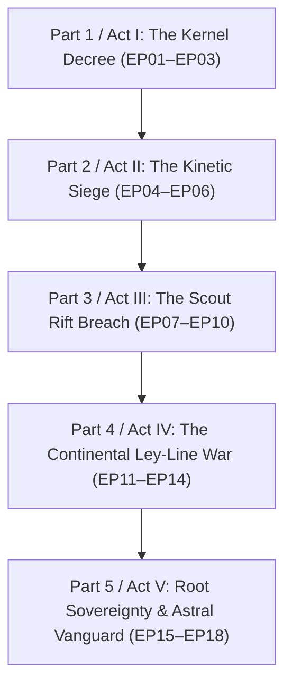

# 🎬 Series Bible: Zero Crown — Root Admin of the Merged Earth

> **[PLANNING PHASE DATA LOCKED — PRE-VAULT REVIEW]**  
> This Series Bible defines the canonical lore, grounded economy, bounded Admin mechanics, unified entity roster, and 18-episode multi-arc roadmap for **Series 09** (Blueprint #15).  
> **Pending Next Gates (After Operator Review):** Stage 1 Vault Lock (`vault/entities.json`, `vault/zones.json`, `character_vault/` reference plates) and World Setting Visual Selection.

> **Series ID:** `series_09` (`Series_09_Cash_VR_Root_Admin_Merge`)  
> **Franchise Code:** `FRAN-VRA-009`  
> **Canonical Title:** *Zero Crown: Root Admin of the Merged Earth*  
> **Blueprint Source:** `#15 — I Soloed The Final Boss Of The World's #1 Cash VR Game, Claiming Unrestricted Admin Access As Earth Merged For The Dimensional War`  
> **Format:** 16:9 Full-Bleed Landscape (`1920x1080`) — Single-Panel Horizontal Composition  
> **Release Cadence:** Discrete Act / Part Feature Model (`Part 1` .. `Part 5` / `Complete`, ≥ 60 mins per compiled Act)  
> **Narrative Archetype:** Open-Power Solo Rank #1 • Cash-Economy VR Convergence • Bounded Kernel Admin • Cosmic Invasion Survival  
> **Studio Core Standard:** Manhwa Recap Studio Anti-Slop Codex (`00_Engine/00`) & Universal Arithmetic Codex (`00_Engine/05`)

---

## 🏛️ World Overview, Causal Infrastructure & Social Hierarchy

### 1. The Crucible Accord & How *Pantheon Online* Was Built (Zero Causal Skips)
Twelve years prior to the opening of Episode 1, an orbital gravitational anomaly designated **The Cradle Signal** transmitted compressed spatial-runic quantum architecture to a secret United Nations defense steering committee (**The Global Crucible Accord**). Recognizing the signal as both a warning and an evolutionary survival protocol, world governments contracted five sovereign mega-corporations (**The Sovereign Directorate**, led by **Apex Zaibatsu** and **Helios Heavy Industries**) to construct a global neural-immersion infrastructure disguised as the commercial VRMMO ***Pantheon Online***.

* **Public Economic Integration:** To maximize human neural adaptation rates, governments linked *Pantheon Online* dungeon-core yields directly to regulated Central Bank exchanges. Citizens who cleared rifts inside VR harvested mana-crystallized data cores whose computational output powered orbital defense batteries, allowing players to cash out verified dungeon drops into real-world Sovereign Credits.
* **Pre-Positioned Physical Defense Infrastructure:** Under classified defense budgets over those same twelve years, the Crucible Accord and Directorate built dual-use **Aegis-Rune Containment Pylons** disguised as geothermal relays and telecommunications towers across major capitals (including Neo-Seoul), alongside reverse-engineered *Pantheon*-alloy strike helicopters, tactical APCs, and mana-shielded exosuits. When server-reality synchronization fires in Episode 1, these dormant physical circuits activate instantaneously—explaining why ministries and corporate militias possess operational containment barriers and strike gear on Day 1.

### 2. How the Mega-Corporates Obtained the 30-Day Invasion Leak
Three years before Convergence, Apex Zaibatsu's Chief Systems Architect intercepted a fragmented kernel telemetry packet from the 100th-Floor Seal (**The Architect's Covenant Mirror**). The leaked packet revealed two suppressed facts:
1. Slaying the 100th-Floor Final Boss (**Chronos, The Dimensional Architect**) triggers physical Server-Reality Synchronization across Earth and starts a hard **720-hour (30-day) countdown** before the **Higher-Dimensional Sovereign Vanguard** arrives.
2. The player landing the final blow inherits **Genesis Kernel Root Admin Authority** over Earth's newly manifested Crucible Operating System.

Rather than disclose the invasion, the Top 5 Conglomerates formed a cartel to buy out high-tier auction liquidity, lock solo progression gates behind guild tariffs, and stall Floor 100 attempts until Apex heir **Min-Jae Baek** could secure the killing blow with a 2,000-man corporate raid.

### 3. Immediate Scan-Failure & Appraisal Rejection Protocol
Whenever a civilian guild terminal, Defense Ministry scanner, or corporate field tablet scans **Shin Kang** after Convergence and returns `[ERROR: UNREGISTERED / NULL / LEVEL-1 CIVILIAN]`, the narrative immediately specifies the technical cause:
* Commercial and ministry scanners query the **Consumer-Tier Guild API (`Ring-3 Ledger v4.2`)**, which indexes licensed corporate guild contracts and cash-shop asset hashes.
* Shin's unguilded `Zero_Crown` profile bypassed commercial registries, and his post-merge status resides in the **Kernel-Level Genesis Hypervisor (`Ring-0 Architect Bus`)**. Lower-tier `Ring-3` scanners lack read authorization for `Ring-0` signatures, throwing a `403/NULL` fallback that mid-tier corporate officers initially misread as an unawakened zero-tier civilian—until a senior systems lead or executive inspects the raw bus exception.

---

## ⚡ Power System, Grounded Economy & Bounded Root Admin Mechanics

### 1. Grounded 3-Tier Currency & Core Bounty Scale (`00_Engine/05`)
Arbitrary billion/trillion-dollar inflation is strictly purged. All VR-to-Earth cash-outs and corporate contracts adhere to the **Imperial Sovereign Standard**:

| Tier | Symbol | Ratio & Purchasing Power | In-World & Post-Merge Benchmarks |
| :--- | :---: | :--- | :--- |
| **Copper** | `cp` | $1\text{ cp} \approx \text{£1}$ | Transit fare (`2 cp`), street rations (`10 cp`), minor stamina tonic (`25 cp`). |
| **Silver** | `sp` | $1\text{ sp} = 100\text{ cp} \approx \text{£100}$ | Alloy combat blade (`15 sp`), monthly Neo-Seoul studio rent (`50 sp`), F-Rank Core (`20–40 sp`). |
| **Gold Sovereign** | `gp` | $1\text{ gp} = 100\text{ sp} \approx \text{£10,000}$ | Grade-1 enchanted armor (`5 gp`), Gate raid charter (`250 gp`), high-tier corporate black-ops bounty (`1,500–2,500 gp`). |

* **Dungeon Core Exchange Benchmarks:** F-Rank (`20–40 sp`), E-Rank (`1–2 gp`), D-Rank (`5–8 gp`), C-Rank (`25–40 gp`), B-Rank (`100–150 gp`), A-Rank (`500–800 gp`), S-Rank (`3,000–5,000 gp`).

### 2. Level Cap (`100`), EXP Curve & Attribute Physics
* **Hard Level Ceiling:** **Level 100** is the absolute physiological synchronization limit of a human vessel.
* **Attribute Baseline:** Unawakened adult baseline = `10`; every level grants exactly **+3 Stat Points**.
* **Compression & Synchronization:** Shin Kang reached Level 99 inside *Pantheon Online* on pure solo mechanical clears. Upon Earth Convergence, physical biological stress compresses his manifestation to **Level 78 (National Sovereign Tier)**—still vastly ahead of cash-shop Level 45–55 corporate captains—leaving a clear **Lv 78 $\rightarrow$ Lv 100** progression runway through Act II–V solo rift clears.
* **Absolute Durability Law:** Effective Damage $= \max(0, \text{Incoming Impact} - (\text{CON} \times \text{Density Factor}))$. Lower-tier projectiles shatter or deflect off S-tier barrier density, whereas conventional heavy orbital ordinance or Dimensional Sovereign attacks can still breach Shin's defenses if his mana reserves or stance guard fail.

### 3. Bounded Root Admin Authority (`Genesis Kernel — Ring-0`)
Unlocked by solo-slaying `Chronos`, Shin's Root Admin access is **powerful, decisive, and strictly bounded**—never an omnipotent "delete all enemies" button:
1. **Kernel Authority Points (KAP) & Rift Fuel:** Every macro command (`Revoke_Guild_Assets`, `Patch_Gate_Boundary`, `Redirect_Ley_Conduit`) consumes **KAP**, replenished strictly by solo-clearing active Dimensional Rifts and absorbing Sovereign Cores.
2. **Crucible Jurisdiction Only:** Root Admin commands govern *Pantheon*-originated infrastructure: corporate guild charters, manifested VR armor/weapons, Earth-side Dungeon Gates, and Crucible Aegis Pylons. **Higher-Dimensional Sovereign Invaders** run on an external alien physics lattice (`Out-of-Band Entities`) and are immune to remote deletion—Shin must physically fight and slay them with his swordplay and localized terrain overrides.
3. **Cooldown & Stability Locks:** Planetary-scale asset revocations or sector quarantines incur hard **24-hour to 72-hour kernel cooldowns** and broadcast telemetry traces, forcing Shin to calculate exact timing windows against corporate tactical countermoves.

---

## 👥 Protagonist Invariants & Unified Entity Roster (Planning Baseline)

### Mandatory Protagonist & World Governance Laws
* **Open Power (Zero Sandbagging):** Shin deploys his Rank #1 sword mastery and Root Admin halo openly from Scene 1. He never pretends to be weak.
* **Smart & Reactive MC (Zero Nonchalant Slop):** Shin never stands hands-in-pockets deadpan while allies or civilians are endangered. He visibly tracks boss recovery frames, helicopter firing arcs, KAP cooldown timers, and sister **Hana Kang**'s safety under genuine tension.
* **Solo Grinding Bias:** Shin clears dungeon floors, anomaly rifts, and elite bosses solo by default, coordinating with **K-Aegis Command** only when simultaneous multi-city rifts make solo coverage physically impossible.
* **Normal-IQ Antagonists (~70% Smart / ~30% Plausible Hubris):** Conglomerate Chairman **Do-Hyun Baek** adapts immediately after losing system gear—pivoting to conventional kinetic strikes (missiles/artillery exempt from Crucible OS revocation), legal freezes, and cooldown exploitation—while mid-tier heirs (`Min-Jae Baek`) carry the plausible pay-to-win hubris needed for Act 1 retribution.

### Core Entity Roster (Prepared for Future Stage 1 Vaulting)
* **Protagonist:** `@{Shin Kang}` (Age 21, ID: `Zero_Crown`) — Matte-black high-collar tactical coat over dark street knitwear, sharp slate-gray eyes, silver-white combat gloves, twin-edged dark metallic `@{Sovereign's Eclipse Blade}`, floating golden-crimson `[ROOT ADMIN]` hexagonal halo behind shoulders when kernel commands execute.
* **Protected Family:** `@{Hana Kang}` (Age 17) — Shin's younger sister and Neo-Seoul high school honors student; wears a dark navy academy blazer; motivation anchor for Shin's Earth defense calculations.
* **Floor 100 Final Boss:** `@{Chronos, The Dimensional Architect}` — 4-meter crystalline-gold clockwork colossus veiled in fractured spatial rings and twin astral greatswords.
* **Corporate Mastermind (70% Calculating):** `@{Chairman Do-Hyun Baek}` (Age 58) — Apex Zaibatsu Chairman in bespoke charcoal pinstripe suit with silver rimless glasses; pivots swiftly from system monopoly to conventional orbital/kinetic warfare once Crucible assets are revoked.
* **Corporate Heir (30% Hubris):** `@{Min-Jae Baek}` (Age 24) — Apex Raid Heir in gilded mythril-plated corporate paladin armor before revocation; stripped to Level-1 burlap starter gear live on broadcast in Act 1.
* **Defense Ministry Lead:** `@{Director Ji-Won Seo}` (Age 46) — Head of K-Aegis Containment Command in dark olive-black strategic defense uniform; pragmatic realist who negotiates bounded defense treaties with Shin.
* **Act III–V Cosmic Antagonist:** `@{Vaelen, Herald of the Astral Spire}` — Higher-Dimensional Vanguard Commander clad in iridescent violet-obsidian void carapace; immune to direct Kernel deletion.
* **Signature Weapon & Relic:** `@{Sovereign's Eclipse Blade}` (twin-edged matte-obsidian & gold-veined longsword) and `@{The Architect's Covenant}` (cracked primordial sapphire-and-gold slate detailing the 720-hour invasion protocol).

---

## 🏰 Canonical World Setting & Spatial Enclosures

1. **`abyssal_sanctum_99` (99th Abyssal Sanctum):** Vaulted subterranean obsidian cavern lit by bioluminescent cyan fault-lines and floating cracked stone causeways (`abyssal`).
2. **`chronos_throne_spire` (100th-Floor Boss Spire):** Colossal circular astral observatory suspended above golden wireframe gridlines, ringed by shattered clockwork monoliths (`abyssal`).
3. **`neo_seoul_balcony_district` (Neo-Seoul Convergence Zone):** Rain-slicked modern concrete high-rise apartment terrace overlooking glass towers, dormant Aegis-Rune Containment Pylons erupting with cyan light, and hovering corporate strike helicopters (`day` / `night`).
4. **`apex_sky_citadel` (Apex Zaibatsu Command Penthouse):** Brutalist dark-glass boardroom overlooking Neo-Seoul's skyline, fitted with tactical holo-tables and blast shutters (`interior`).
5. **`aegis_containment_bunker` (K-Aegis Defense Command):** Subterranean steel-and-concrete military war room lined with live dimensional rift telemetry screens (`interior`).

---

## 🗺️ Master Multi-Episode Arc Roadmap (18 Episodes • 5 Discrete Acts)

### Part 1 — Act I: The Convergence & The Kernel Decree (`EP01 – EP03`)
* **EP01: The Covenant Tablet & The Solo 100th Floor** — Shin Kang loots `The Architect's Covenant` on Floor 99, exposing the Crucible Accord's 12-year infrastructure and the 30-day invasion leak. Ambushed by Apex's 2,000-man blockading squad at 1% HP, he executes a frame-perfect boss-door parry glitch to enter the 100th Floor solo and fights `Chronos` in a razor-thin mechanical duel.
* **EP02: Sky Shatter & The Live Asset Revocation** — Shin slays `Chronos`, triggering Earth Convergence (`T-Minus 720:00:00`) and activating dormant Aegis-Rune Pylons worldwide. When Min-Jae Baek's strike helicopters surround Shin's Neo-Seoul apartment block to claim illegal jurisdiction, Shin steps onto his balcony, opens his bounded Root Console, and executes `Revoke_Guild_Assets(Apex_Zaibatsu)`—stripping Min-Jae's mythril raid force into starter burlap on live global feeds while incurring a 72-hour macro-revocation cooldown.
* **EP03: The Ring-3 Scan Trap & K-Aegis Accord** — Ministry field auditors attempt to detain Shin when consumer `Ring-3` scanners return `NULL_CLASS`; Shin exposes the API blind spot openly before Chairman Do-Hyun Baek cuts power to Neo-Seoul's civilian grid using non-system corporate infrastructure. Shin brokers a strict non-interference perimeter with Director Ji-Won Seo to protect Hana while keeping his solo clearing mandate intact.

### Part 2 — Act II: The Kinetic Siege (`EP04 – EP06`)
* **EP04: Out-of-Band Ballistics** — Recognizing that Crucible gear is vulnerable to Root revocation, Chairman Baek deploys conventional non-system mercenary artillery and kinetic rail-drones exempt from Kernel jurisdiction, trapping Shin in an active urban battle enclosure while his macro-command remains on cooldown.
* **EP05: The Subterranean Ley-Node Raid** — Under live kinetic pressure, Shin solo-clears an emerging B-Rank Anomaly Gate beneath Gangnam Station to farm `KAP` fuel and level from Lv 78 to Lv 84, unlocking localized `Patch_Gate_Boundary(50m)` terrain redirection.
* **EP06: Citadel Breached & Cartel Restructuring** — Shin infiltrates Apex Zaibatsu's Sky-Citadel using physical swordcraft and bounded terrain patches, dismantling Baek's mercenary command and seizing the Directorate's stolen **Cradle Signal Telemetry**—exposing the exact orbital entry coordinates of the first Vanguard fleet at `T-Minus 500 Hours`.

### Part 3 — Act III: The Scout Rift Breach (`EP07 – EP10`)
* **EP07: The First Out-of-Band Vanguard** — Ahead of schedule, an advance dimensional fissure opens over Busan Harbor, spilling `Out-of-Band` Void Constructs completely immune to remote Kernel deletion.
* **EP08: Mechanics Over Commands** — Shin leads no party; he enters the Busan Rift alone, discovering that while Admin delete commands fail on alien invaders, he can apply Kernel terrain multipliers (`Gravity_Coefficient`, `Gate_Pressure`) around his own blade to shatter their void shells.
* **EP09: The Dual-Rift Dilemma** — Simultaneous S-Rank anomalies erupt in Tokyo Bay and Incheon. Unable to physically occupy two continents at once, Shin temporarily transmits kernel authorization keys to Director Seo's K-Aegis batteries to hold Incheon's perimeter while he solo-hunts the Busan Rift Commander.
* **EP10: Herald's Shadow** — Shin reaches Lv 92 after slaying the Rift Commander, only for `Vaelen, Herald of the Astral Spire` to project an astral avatar across the cracked sky, cutting the 720-hour invasion clock in half.

### Part 4 — Act IV: The Continental Ley-Line War (`EP11 – EP14`)
* **EP11–EP12: The Five-Pylon Synchronization** — Shin races solo across Asia-Pacific Crucible Nexus Gates to stabilize Earth's fractured mana ley-lines, battling rogue Directorate remnants who attempt to sell planetary coordinates to the invaders for off-world asylum.
* **EP13–EP14: Level 100 Threshold & Kernel Overclock** — Clearing the Marianas Abyssal Spire solo pushes Shin to the **Level 100 Physiological Cap**, unlocking `Kernel Overclock`—allowing temporary synchronized weapon-buffing of Earth's planetary Aegis Pylon network.

### Part 5 — Act V: Root Sovereignty & The Astral Sovereign (`EP15 – EP18`)
* **EP15–EP16: Orbital Convergence** — The Higher-Dimensional Vanguard Armada breaches Earth's upper atmosphere; K-Aegis and reformed guild militias hold civilian evacuation corridors while Shin ascends the Orbital Crucible Spire alone.
* **EP17–EP18: The Astral Spire Duel & New Genesis** — Shin confronts `Vaelen` and the Astral Fleet Commander in a pure high-speed sword-and-kernel showdown, severing Earth's Crucible OS from invader control and locking humanity's sovereign planetary barrier permanently into reality.

---

## ⚖️ Production & Pacing Invariants (For Future Stage 2–4 Execution)
1. **16:9 Single-Panel Full-Bleed:** Zero multi-panel comic strips (`min_multi_panel_ratio: 0`).
2. **Dynamic Scene Pacing:** Target `~45–50` words per scene (`<= 8s` narration hold) with continuous spatial enclosures (zero mid-battle errands, zero prop flickering).
3. **Prop Minimization:** Restrict active hero props strictly to `@{Sovereign's Eclipse Blade}` and `@{The Architect's Covenant}` (when plot-active).

---

## 🎨 Studio & Google Flow Master Directives (SSOT)

<!-- STUDIO_BIBLE_DIRECTIVES_START
{
  "styleName": "Zero Crown (Modern Dark Urban Fantasy & Cyber-VR Convergence)",
  "format": "16:9",
  "voiceId": "en-US-ChristopherNeural",
  "genreRule": "Modern dark urban fantasy and sci-fi VR action manhwa webtoon art style, sharp black ink linework, crisp atmospheric illumination, vibrant high-contrast cel shading, textless 16:9 horizontal widescreen landscape aspect ratio (1920x1080 horizontal full bleed). Neo-Seoul concrete and glass high-rise metropolis transformed by glowing cyan Crucible Aegis-Rune pylons, fractured golden-code sky convergences, abyssal obsidian VR sanctums, and high-tech military containment perimeters.",
  "forbiddenRule": "STRICTLY FORBIDDEN STYLE DRIFT: Never generate medieval knights, peasant villages, parchment scrolls, or Victorian doublets in modern Neo-Seoul scenes. Never depict Shin Kang smiling nonchalantly with hands in pockets during lethal crises. Never inject raw algebraic math, LaTeX formulas, or developer meta-jargon into spoken scripts. Never render floating disembodied hands touching holographic Admin screens.",
  "crowdRule": "Softly blurred diverse background soldiers, panicked commuters, or corporate operators permitted ONLY in public Neo-Seoul plazas, raid blockades, and K-Aegis command halls. In Shin's apartment, Chronos's 100th-Floor throne chamber, and solo dungeon runs, enforce strict isolation with zero extraneous bystanders.",
  "defaultVaultDna": "modern dark urban fantasy action manhwa art style, sharp black ink linework, crisp cinematic lighting, vibrant high-contrast cel shading, sleek modern tactical streetwear and sci-fi cyber-runic armor, pure textless artwork",
  "exampleEntities": [
    "@{Shin Kang}",
    "@{Hana Kang}",
    "@{Chronos, The Dimensional Architect}",
    "@{Chairman Do-Hyun Baek}",
    "@{Min-Jae Baek}",
    "@{Director Ji-Won Seo}",
    "@{Vaelen, Herald of the Astral Spire}",
    "@{Sovereign's Eclipse Blade}",
    "@{The Architect's Covenant}"
  ],
  "vocabulary": {
    "diegeticScrolls": "encrypted quantum data slates/cracked primordial tablets",
    "diegeticSignage": "illuminated corporate conglomerate monoliths/K-Aegis perimeter beacons",
    "diegeticSteles": "Aegis-Rune containment pylons/obsidian clockwork spire monoliths",
    "diegeticUi": "translucent golden-crimson Root Admin wireframe windows/cyan Crucible telemetry rings"
  },
  "spatialEnclosures": {
    "abyssal_sanctum_99": "Cavernous subterranean obsidian sanctuary lit by glowing cyan rift fault-lines and suspended shattered basalt bridges.",
    "chronos_throne_spire": "Colossal circular astral observatory suspended above golden wireframe geometry, ringed by towering fractured clockwork monoliths.",
    "neo_seoul_balcony_district": "Rain-slicked high-rise concrete balcony overlooking modern Neo-Seoul glass skyscrapers, activated cyan Aegis-Rune containment pylons, and hovering dark corporate strike helicopters.",
    "apex_sky_citadel": "Brutalist dark-glass corporate penthouse war room overlooking Neo-Seoul skyline with armored blast shutters and crimson tactical holo-tables.",
    "aegis_containment_bunker": "Subterranean reinforced steel-and-concrete military command center lined with glowing blue dimensional rift telemetry displays."
  }
}
STUDIO_BIBLE_DIRECTIVES_END -->
