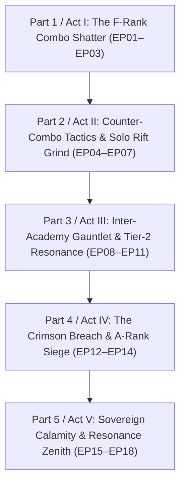

# 🎬 Series Bible: Consecutive Hit Resonance (`Series_10_Consecutive_Hit_Resonance`)

> **Series ID:** `series_10` (`Series_10_Consecutive_Hit_Resonance`)  
> **Code:** `FRAN-CHR-010`  
> **Canonical Title:** *My Academy Talent Stacks +35% Damage Per Hit So 1-Mana Strikes Slay S-Ranks*  
> **Format:** 16:9 Full-Bleed Landscape (`1920x1080`)  
> **Release Cadence:** Discrete Act / Part Model (`(Part 1)`..`(Complete)`, $\ge 60$ mins per Act feature)  
> **Narrative Archetype:** Tactical Academy Duelist • Open Consecutive-Hit Multiplier • Solo Rift Grinder  
> **Studio Core Standard:** Manhwa Recap Studio 8 Core Pillars, Grounded Codex Math (`00_Engine/05`), Smart/Reactive Protagonist, Zero Causal Skips

---

## 🏛️ 1. World Overview, Institutional Infrastructure & Causal Lore

### 1. The Aurelian Kingdom & The Royal Astoria Academy
Set in the high-magic **Aurelian Kingdom**, hunter education and national rift defense revolve around **Royal Astoria Academy**—a state-chartered fortress campus funded by Crown Rift Tithes (`40%` of all harvested dungeon monster cores from student trial gates go to the Royal Treasury) and aristocratic tuition (`50 gp` per semester, waived only for scholarship cadets who clear monthly core quotas).

### 2. Zero Causal Skips: How & Why Academy Apparatus Exists
Every institutional barrier, golem, and dungeon portal at Astoria has a concrete economic and arcane supply chain:
* **Obsidian Placement Golems:** Cast by the Imperial Artificer Guild from volcanic *Null-Basalt* quarried in the Ashfall Caldera and powered by standardized `D-Rank` monster cores (`5–8 gp` per unit) under a Crown Defense Grant. Why single-strike evaluation? Royal Vanguard doctrine prioritizes heavy alpha-strike mages and halberd knights capable of breaking monstrous charges in one opening blow; consequently, the golem's internal **Peak-Impact Crystal** measures only maximum instantaneous force inside a strict **1.0-second telemetry window**, then purges its buffer to `0` so examiners can sort 400 freshmen in under two hours.
* **Arena Barrier Pylons:** Brass-and-quartz perimeter pillars wired into Astoria's subterranean geothermal leyline cistern. Freshman rings project `C-Rank` containment shells (`4,000 HP` absorption threshold) and automatically trip an emergency ward-drop when structural integrity falls below `10%` to prevent lethal collateral damage during ranked spars.
* **Sub-Basement Dungeon Access Gates:** Naturally occurring dimensional rifts stabilized beneath Astoria's granite vaults using heavy iron-and-runestone *Gate Collars* leased from the Imperial Rift Authority (`250 gp` standard commercial license, subsidized under Astoria's cadet charter). Gates regenerate monster fauna every 72 hours from ambient rift density, functioning as controlled training and core-harvesting grounds.

### 3. Immediate Talent-Failure Lore (Why Kaelen Was Graded F-Rank)
During Freshman Placement, 18-year-old scholarship cadet **Kaelen Cross** steps up to the Obsidian Placement Golem and delivers a clean opening strike with his `15 sp` iron-steel twin spell-dagger (`Arcane Fang`). Because his awakened talent **`Relentless Resonance`** begins at **0 Stacks (`1.0x` base output)**, his single permitted blow registers only `15 Units` against the `40-Unit` minimum threshold. The golem's 1.0-second crystal logs `F-RANK / FAILED` and flushes its kinetic-mana buffer before Kaelen can land a second hit.
* **No Hidden Powers & Smart Reaction:** Kaelen does not shrug passively or hide his power. Seeing the glowing 1.0-second reset glyph pulse on the golem's chestplate, he immediately deduces the mechanical flaw—single-sample telemetry cannot read cumulative consecutive strikes—and challenges the grading methodology openly as soon as he is placed in a live continuous-combat spar where no 1-second crystal wipes his chain.

---

## ⚡ 2. Power System, Grounded Math & Combo Resonance Codex

All progression, combat physics, and economic transactions strictly obey `00_Engine/05_Universal_Arithmetic_and_Economy_Codex.md`.

### 1. Grounded Economy & Gear Progression
* **Currency Standard:** `1 gp` (`£10,000`) = `100 sp` (`£100`) = `10,000 cp` (`£1`).
* **Monster Core Bounties:** `F-Rank` (`20–40 sp`), `E-Rank` (`1–2 gp`), `D-Rank` (`5–8 gp`), `C-Rank` (`25–40 gp`), `B-Rank` (`100–150 gp`), `A-Rank` (`500–800 gp`), `S-Rank` (`3,000–5,000 gp`).
* **Kaelen's Starting Economics:** Scholarship orphan living on `50 sp/month` dorm stipend (`5 cp` bread, `15 sp` per standard iron spell-dagger, `25 sp` minor mana draught). Every solo dungeon clear directly funds better blade steel, stamina tonics, and independent rift permits.

### 2. Level Cap, EXP Curve & Absolute Durability Rule
* **Level Cap:** `Lv 100` (hard physiological ceiling). **Standard Human Baseline:** `10` per attribute. **Stat Growth:** `+3 stat points` per level up.
* **EXP Requirements:**
  * **Lv 1–10 (Cadet / Novice):** `500 -> 1,200 EXP/lvl` (`F-Rank Beast`: `30–50 EXP`; `E-Rank Beast`: `150–250 EXP`).
  * **Lv 11–25 (Vanguard / D-Rank):** `2,500 -> 6,000 EXP/lvl` (`D-Rank Boss`: `1,200 EXP`).
  * **Lv 26–50 (Elite / C–B Rank):** `12,000 -> 30,000 EXP/lvl`.
  * **Lv 51–75 (High Commander / A-Rank):** `60,000 -> 150,000 EXP/lvl` (`A-Rank Goliath`: `25,000 EXP`).
  * **Lv 76–100 (Sovereign / S-Rank):** `300,000 -> 1,000,000 EXP/lvl` (`S-Rank Calamity`: `150,000 EXP`).
* **Absolute Durability Rule:**
  $$\text{Effective Damage} = \max(0, \text{Incoming Strike Energy} - (\text{CON} \times \text{Density Factor}))$$
  When $\text{Attack} - \text{Defence} \le 0$, the strike inflicts **0 damage**. Kaelen's opening hits bounce harmlessly off armored shields or monster carapaces until consecutive stacks push his output above the target's Defence threshold.

### 3. `Relentless Resonance` — Grounded Additive Stacking & Tactical Reset Rules
Kaelen pairs his innate talent **`Relentless Resonance`** with rapid twin spell-dagger slashes and a `1-MP Arcane Needle` cantrip (`14` base kinetic-mana force per needle, `60 MP` pool at Lv 1 rising with Intelligence/Spirit).

| Talent Tier | Unlock Horizon | Stack Increment (Additive) | Hard Stack Cap | Peak Multiplier |
| :--- | :--- | :---: | :---: | :---: |
| **Tier 1: Cadet** | Lv 1–15 (Act I) | `+35%` per consecutive hit | **20 Stacks** | `+700%` (`8.0x` Base) |
| **Tier 2: Vanguard** | Lv 16–35 (Act II–III) | `+50%` per consecutive hit | **25 Stacks** | `+1,250%` (`13.5x` Base) |
| **Tier 3: Elite** | Lv 36–65 (Act IV) | `+75%` per consecutive hit | **30 Stacks** | `+2,250%` (`23.5x` Base) |
| **Tier 4: Sovereign** | Lv 66–100 (Act V) | `+100%` per consecutive hit | **35 Stacks** | `+3,500%` (`36.0x` Base) |

* **Hard Reset Conditions (Real Combat Risk — Zero Free Wins):**
  1. **Clean Parry or Complete Miss:** If an enemy completely evades a swing or deflects Kaelen's blade cleanly without taking contact, the resonance chain snaps immediately back to **0 Stacks**. *(Note: Striking an active mana shield or carapace counts as physical target contact and feeds the stack.)*
  2. **Target Switch:** Striking any second enemy, decoy, or summon immediately zeroes all stacks built on the first target.
  3. **2.5-Second Decay Window:** Failing to land a hit on the locked target within `2.5 seconds` dissipates the crimson resonance ring back to `0`.
  4. **Mana & Stamina Economy:** Each `Arcane Needle` costs `1 MP`. Firing a 12-needle burst drains `12 MP`—meaning Kaelen must pace dagger-feints, breathing intervals, and mana recovery rather than spamming blindly.
* **Act I Benchmark Proof (Viktor Thorne Spar):**
  * **Viktor Thorne (Lv 12 Noble Scion):** Channels an heirloom `C-Rank` ring (`35 gp`) to manifest *Iron Tortoise Bulwark*: **`3,500 HP` Shield Integrity / `45` Effective Defence** (built to stonewall standard `100–250` damage freshman bursts).
  * **Kaelen Cross (Lv 3):** Base strike `16` (dagger) / `14` (`1-MP Arcane Needle`). Hits #1–#3 deal **`0` net damage** (`16 < 45`), letting Viktor laugh aloud (`30%` plausible arrogance). Hits #4–#8 breach `45` Defence and spiderweb the dome; Hits #9–#20 (`3.8x` to `8.0x` base, `60–128` net damage per rapid strike across 3.5 seconds of non-stop footwork + needle volleys) exhaust the `3,500 HP` shield matrix and slam Viktor into the arena apron.

---

## 👥 3. Narrative & Protagonist Invariants (Non-Negotiable)

1. **No Hidden Powers:** Kaelen fights openly, announces his combo mechanics when pressed by faculty, and refuses to sandbag for dramatic convenience.
2. **Smart & Reactive MC (Banned Nonchalant):** Zero hands-in-pockets stoicism or deadpan boredom. Kaelen tracks enemy shield recovery cycles, reads shoulder tells to anticipate parries, sweats under mana strain, and visibly pivots tactics when opponents counter his chain.
3. **Solo Grinding Bias:** Kaelen clears Academy trial gates and frontier rifts **solo by default**—party allies disrupt target-lock continuity and risk stray hits stealing aggro. Temporary alliances happen only under mandatory multi-squad exam rules or city-wide breach containment, where Kaelen isolates an independent boss lane.
4. **Normal-IQ World (~70% Smart / ~30% Plausible Initial Underestimation):** After Act I's shield-break, examiners and rivals adapt rationally. Opponents deploy **parry-bucklers, blink-evasion boots, decoy golems (forcing target-switch resets), and AoE denial zones** to break his `2.5s` combo timer.

---

## 📜 4. Complete Unified Entity & Zone Roster (Planning Seed)

### Characters & Bosses
* **`@{Kaelen Cross}`** — 18-year-old tactical duelist; lean athletic build, sharp dark-grey eyes, tousled black hair, wearing a **fitted midnight-blue Astoria Academy combat uniform** with silver cuff piping and dual hip sheaths. Smart, alert, expressive under pressure.
* **`@{Viktor Thorne}`** — 19-year-old Lv 12 Noble Vanguard Scion; broad-shouldered, platinum-blond hair, crimson-trimmed white noble coat, wielding an emerald **Aegis Tortoise Bulwark Ring**. Overconfident initially, later adopts reactive counter-shield tactics.
* **`@{Chief Examiner Marcus Vance}`** — 42-year-old veteran Imperial Battlemage; stern silver-templed hair, slate-and-gold examiner coat. Follows Army single-strike quota strictly until seeing Kaelen's telemetry, then swiftly recalibrates Academy combat brackets.
* **`@{Dean Evelyn Voss}`** — 50-year-old 6th-Circle Grand Archmage of Astoria; composed aristocratic bearing, deep indigo-and-gold chancellor robes. Protects Kaelen's solo rift access from noble interference in exchange for Crown-shared dungeon telemetry.
* **`@{Seraphina Crowe}`** — 18-year-old Lv 14 Duelist Prodigy of House Crowe; sleek silver-white hair, rapier-and-buckler fencing stance. The first smart rival to study Kaelen's `2.5s` decay window and actively parry to reset his stacks.
* **`@{Lord Damian Vane}`** — 21-year-old Third-Year Student Council Commander (Lv 28); calculating noble tactician using mirror-decoy constructs specifically to punish single-target combo locks.
* **`@{Obsidian Gate Behemoth}`** — Act II Solo Boss (Lv 24 D/C-Rank Anomaly); hulking volcanic-plate quadruped with rhythmic slam shockwaves designed to zone melee duelists past `2.5s`.
* **`@{Abyssal Dread-Knight Vaelor}`** — Act IV/V S-Rank Calamity Sovereign (Lv 78); towering obsidian-armored rift commander wielding a parry-capable greatsword and phase-step blinks.

### Signature Props & Zones
* **`@{Arcane Fang Twin Daggers}`** — Matched pair of slender dark-steel short spell-daggers with runic fullers emitting crisp crimson resonance trails as stacks climb (`+35%` -> `+700%`).
* **`@{Obsidian Placement Golem}`** — 3-meter Null-Basalt statue with a recessed chestplate **1-Second Peak-Impact Crystal** that flashes rank glyphs and resets to zero between blows.
* **`@{Aegis Tortoise Bulwark Ring}`** — Gold-and-emerald `C-Rank` heirloom signet projecting hexagonal defensive barrier facets.
* **Core Zones:** `Astoria Placement Courtyard` (daylight granite plaza with twin obsidian monoliths and placement golems), `Astoria Dueling Amphitheater` (sunken limestone ring ringed by brass-and-quartz barrier pylons), `Sub-Basement Trial Gate 04` (torch-lit subterranean stone vault housing iron-collared E/D-Rank rift portals), `Ashfall Frontier Gorge` (craggy basalt rift canyon for Tier-2+ solo boss hunts).

---

## 🗺️ 5. Master Multi-Episode Arc Roadmap (18 Episodes • 5 Discrete Acts)

### Part 1 / Act I: The F-Rank Combo Shatter (`EP01 – EP03` | Target: ~75–90m Feature)
* **EP01: The One-Second Golem & The 3,500-HP Tortoise Shell**  
  *Placement Failure:* Kaelen's single dagger strike logs `15 Units` on the Astoria Obsidian Golem before its 1.0-second crystal wipes to zero. Assigned to Class 12, he deduces the telemetry blind spot and openly declares his consecutive-hit resonance before facing Lv 12 scion **Viktor Thorne**.  
  *First-Act Payoff:* Hits #1–#3 bounce off Viktor's `45-Defence` emerald tortoise shell (`0` net damage). Kaelen adapts with rapid `1-MP Arcane Needle` intervals and twin-dagger angles, pushing to **20 Stacks (`+700%`)** in 3.5 seconds to shatter the `3,500 HP` shell and knock Viktor onto the barrier apron.
* **EP02: Telemetry Audit & Solo Gate 04**  
  *Faculty Adaptation:* Chief Examiner Marcus Vance reviews the barrier pylon logs, verifies zero illicit artifacts, and grants Kaelen solo access to **Sub-Basement Trial Gate 04** (`E-Rank` Kobold Warren) on standard 40% Crown core-tithe terms.  
  *Solo Grind:* Hunting strictly alone so no ally breaks his target locks, Kaelen learns real mana pacing (`60 MP` ceiling), climbs from Lv 3 to Lv 7 (`+12` stats into Agility & Spirit), and harvests `18 E-Rank Cores` (`22 gp` net share) to upgrade his twin spell-daggers.
* **EP03: The Buckler Counter & The Parry Reset**  
  *Normal-IQ Rival:* Top freshman duelist **Seraphina Crowe** studies Kaelen's Viktor footage, spots the `2.5s` decay and clean-parry reset condition, and challenges him in a sanctioned ranking duel using a rune-buckler.  
  *Tactical Pivot:* Seraphina twice snaps Kaelen's chain at 8 stacks with crisp blade parries, forcing Kaelen to abandon linear flurries—using `1-MP Arcane Needles` to bait her guard angles laterally until an off-beat dagger feint slips past her buckler for a 15-stack victory.

### Part 2 / Act II: Counter-Combo Tactics & Solo Rift Grind (`EP04 – EP07` | Target: ~85–105m Feature)
* **EP04: The Council's Decoy Gambit:** Student Council Commander **Lord Damian Vane** deploys twin *Mirror-Puppet Constructs* in a mid-term evaluation to force accidental target-switching resets; Kaelen isolates the real core signature by tracking mana tether density and clears solo.
* **EP05: The Deep-Vault D-Rank Gate:** Kaelen enters a solo D-Rank Iron-Boar cavern to clear his tuition debt (`50 gp`), hitting **Lv 14** and discovering how heavy armor-piercing intervals differ from barrier grinding.
* **EP06: Sabotaged Gate Collar:** Rival noble faction bribes a corrupt rift clerk to under-report the density of Gate 07, sealing Kaelen inside an unstable **Lv 24 Obsidian Gate Behemoth** chamber.
* **EP07: Breaking the Shockwave Timer:** The Behemoth's radial slam knocks Kaelen back every `2.2 seconds`, threatening his `2.5s` chain; Kaelen weaves mid-air `1-MP Arcane Needles` *while tumbling* to keep the resonance timer alive and kills the Behemoth at 20 Stacks, unlocking **Tier 2 Vanguard (`+50%`/stack, Cap 25)**.

### Part 3 / Act III: Inter-Academy Gauntlet & Tier-2 Resonance (`EP08 – EP11` | Target: ~85–105m Feature)
* **EP08–EP09:** Astoria enters the Tri-Academy Frontier Tournament; foreign champions bring **blink-step boots** and **group-formation shields** explicitly briefed on Kaelen's Tier-2 dossier. Forced into a mandatory 3-person bracket (plot-mandatory alliance with Seraphina & Viktor), Kaelen locks the enemy Vanguard Captain in a solo duel lane while allies screen flankers.
* **EP10–EP11:** Tournament Finals against an A-Rank heir (`Lv 34`) wearing enchanted deflection mail; Kaelen pushes to **25 Stacks (`+1,250%`)**, breaking `A-Rank` plate durability (`Absolute Durability Rule`) and earning an Imperial **Tier-C Solo Rift License (`250 gp` value)**.

### Part 4 / Act IV: The Crimson Breach & A-Rank Siege (`EP12 – EP14` | Target: ~75–95m Feature)
* **EP12–EP14:** An unscheduled **A-Rank Crimson Breach** erupts in the Ashfall Frontier Gorge. While Guild regiments hold the perimeter cordon, Kaelen solo-flanks a `Lv 58` **Ash-Drake Goliath** (`25,000 EXP` class), evolving `Relentless Resonance` to **Tier 3 Elite (`+75%`/stack, Cap 30)** and neutralizing the breach core before city walls fall.

### Part 5 / Act V: Sovereign Calamity & Resonance Zenith (`EP15 – EP18` | Target: ~90–110m Feature)
* **EP15–EP18:** The mastermind behind the Rift Collar sabotage triggers an **S-Rank Abyssal Calamity** led by **Dread-Knight Vaelor** (`Lv 78`, parry-capable sovereign). Kaelen ascends past `Lv 70` into **Tier 4 Sovereign (`+100%`/stack, Cap 35)**—where `1-MP Arcane Needles` bridge parry recovery frames into a decisive **35-Stack (`+3,500%`)** finisher that severs the S-Rank Boss core and stabilizes the kingdom's rift network.

---

## ⚖️ 6. Production Pacing & Visual Consistency Rules (`EP01`+)

1. **Dynamic Pulse Pacing:** Target `~45–50` words per scene (`max 8s` TTS duration) driven by active tactical exchanges, clean causality explanations, and physical stakes—zero static dummy-whacking loops.
2. **Strict Prop & Weapon Parity:** Keep Kaelen's visual silhouette locked to `@{Arcane Fang Twin Daggers}` and `1-MP Arcane Needles` (crimson-gold spark trails) without spawning unvaulted trinkets.
3. **16:9 Single-Panel Full-Bleed:** Zero split panels, zero comic strips, zero duplicated character tokens, and zero nonchalant hands-in-pockets posing.

---

## 🎨 7. Studio & Google Flow Master Directives (SSOT)

<!-- STUDIO_BIBLE_DIRECTIVES_START
{
  "styleName": "Consecutive Hit Resonance (Royal Astoria Magic Academy)",
  "format": "16:9",
  "voiceId": "en-GB-RyanNeural",
  "genreRule": "High-fantasy academy action manhwa webtoon art style, sharp black ink linework, crisp atmospheric illumination, vibrant high-contrast cel shading, textless 16:9 horizontal widescreen landscape aspect ratio (1920x1080 horizontal full bleed). Royal Astoria Academy: soaring carved limestone and slate-blue spires, brass-and-quartz arena barrier pylons, carved obsidian test monoliths, subterranean granite rift vaults with heavy iron gate collars, and crisp crimson-gold combo resonance trails.",
  "forbiddenRule": "STRICTLY FORBIDDEN STYLE DRIFT: Never generate modern streetwear, hoodies, sneakers, backpacks, asphalt streets, smartphones, cars, skyscrapers, or digital HUD text boxes. Never use nonchalant hands-in-pockets idle poses in combat. All characters strictly wear tailored high-fantasy academy combat uniforms, noble dueling coats, leather vambraces, or forged armor.",
  "crowdRule": "Softly blurred academy cadets, faculty, and noble spectators permitted ONLY in the Placement Courtyard and Dueling Amphitheater seating tiers. Inside Sub-Basement Trial Gates and Ashfall Rift Canyons, enforce strict solo-grinding isolation with zero extraneous spectators.",
  "defaultVaultDna": "high-fantasy academy action manhwa art style, sharp black ink linework, crisp cel shading, tailored academy fantasy combat attire, textless artwork",
  "exampleEntities": [
    "@{Kaelen Cross}",
    "@{Viktor Thorne}",
    "@{Chief Examiner Marcus Vance}",
    "@{Dean Evelyn Voss}",
    "@{Seraphina Crowe}",
    "@{Lord Damian Vane}",
    "@{Obsidian Gate Behemoth}",
    "@{Abyssal Dread-Knight Vaelor}",
    "@{Arcane Fang Twin Daggers}",
    "@{Obsidian Placement Golem}",
    "@{Aegis Tortoise Bulwark Ring}"
  ],
  "vocabulary": {
    "diegeticScrolls": "wax-sealed academy dossiers/parchment evaluation ledgers",
    "diegeticSignage": "carved stone crest banners/brass pylon markers",
    "diegeticSteles": "Null-Basalt obsidian test golems/runic rift gate collars",
    "diegeticUi": "concentric crimson-and-gold resonance rings/subtle spark trails (textless)"
  },
  "spatialEnclosures": {
    "astoria_placement_courtyard": "Expansive sunlit white-limestone academy courtyard flanked by slate-roofed Gothic arcades, twin runic obelisks, and rowed obsidian placement golems under a clear cobalt sky.",
    "astoria_dueling_amphitheater": "Sunken circular granite dueling arena ringed by glowing brass-and-quartz barrier pylons and tiered stone spectator galleries under open daylight.",
    "sub_basement_trial_gate_04": "Vaulted subterranean stone chamber lit by mounted iron mana sconces, centered around a massive anchored iron-and-runestone rift gate collar pulsing with violet mist.",
    "ashfall_frontier_gorge": "Jagged volcanic basalt canyon streaked with glowing crimson rift fissures and drifting ash under a tense overcast horizon."
  }
}
STUDIO_BIBLE_DIRECTIVES_END -->
