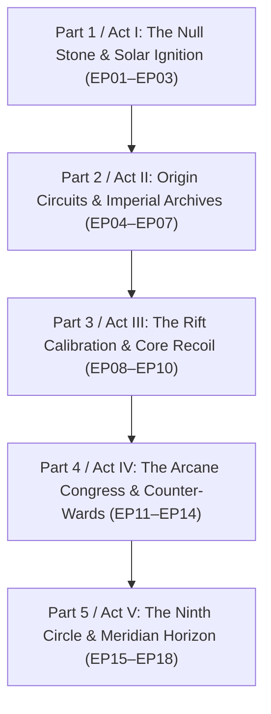

# 🎬 Series Bible: Series 11 — The Proficiency Multiplier Archmage

> **[PLANNING PHASE DATA ONLY — `EP01` DEFERRED PENDING OPERATOR REVIEW]**  
> This Series Bible defines the canonical world architecture, grounded progression math, causal lore, entity roster, and 18-episode roadmap for `Series_11_Proficiency_Multiplier_Archmage` (`series_11` / `FRAN-PMA-011`).  
> *Hard Production Boundary:* No `EPXX/` folders, scripts, prompt matrices, or generated images exist during planning review.

> **Series ID:** `Series_11_Proficiency_Multiplier_Archmage` (`series_11` / `FRAN-PMA-011`)  
> **Canonical Title:** *My Non-Upgradable EXP Multiplier Works On Spells Too, Maxing Forbidden Magic*  
> **Seed Blueprint:** `#29` (*Academy Fixed EXP & Mastery Multiplier*)  
> **Format:** 16:9 Full-Bleed Landscape (`1920x1080`) | Discrete Act / Part Release Cadence (`(Part 1)`..`(Complete)`)  
> **Narrative Archetype:** Open-Power Arcane Researcher • Solo Spell-Circuit Grinder • Institutional Meritocracy & Meridian Lore  
> **Studio Core Standard:** Manhwa Recap Studio 8 Core Pillars, `00_Engine/05` Grounded Arithmetic & Economy, Normal-IQ Opposition

---

## 🔒 Core Narrative & Character Invariants

1. **No Hidden Powers (Open Casting):** Cassian Vale never conceals his accelerated spell-proficiency multiplier or stages fake weakness. He casts openly in class, registers his anomaly with the Academy Tribunal, and leverages faculty curiosity and institutional audits to secure solo-trial permits and restricted archive access.
2. **Smart & Reactive Protagonist (Banned Nonchalant Tropes):** Zero deadpan, emotionless, or hands-in-pockets unbothered tropes. Cassian is a sharp, calculating mage researcher who tests mana-circuit efficiency, anticipates faculty politics, adjusts geometric rune angles mid-cast, and visibly manages **mana-core recoil and meridian heat** whenever a spell surges past its standard circle ceiling.
3. **Solo Grinding Bias:** Cassian conducts spell-lattice research, endurance casting, and dungeon-trial clearances **solo by default**. Rare temporary alliances occur only when explicitly mandated by Academy tournament rules or high-tier containment protocols.
4. **Zero Causal Skips (Meridian & Relic Grounding):** Every major institutional reaction—solar relics igniting across the Imperial Capital, Classroom 1-F's dark-ward shattering, and the 9th-Circle Tower Master teleporting straight into the room—is explicitly grounded in pre-established Imperial architecture and ley-line infrastructure.
5. **Immediate Talent-Failure Lore:** The Academy's `Null / Locked` assessment is explained immediately through technical grading mechanics rather than arbitrary cruelty.
6. **Grounded Math (`00_Engine/05` Compliant):** Zero `100,000 EXP` inflation or 1-cast instant godhood. Progression runs on a fixed `8x` flat EXP and Spell-Proficiency multiplier paired with genuine mana cost, casting fatigue, and `00_Engine/05` metallic currency and level caps.
7. **Normal-IQ World (~70% Calculating / ~30% Plausible Initial Bias):** Instructors, noble rivals, Ministry auditors, and the Tower Master act with rational self-interest, scholarly scrutiny, and real counter-magic—zero cartoon-dumb villains.

---

## 🏛️ World Overview, Talent-Failure Lore & Causal Infrastructure

### 1. The Solarian Empire & The Royal Arcanum Academy
Set in **Solaria**, the high-magic capital of the **Solarian Empire**, arcane authority is governed jointly by the **Royal Arcanum Academy**, the **High Spire Magic Tower**, and the **Imperial Ministry of Arcane Regulation**.
* **Why the Academy Holds Solar Relics & Teleport Anchors (Zero Causal Skips):**  
  Three centuries ago, the Empire's founding Solar Sovereigns built the Royal Academy directly atop the **First Solar Meridian**—a concentrated ley-line nexus beneath the Capital. To prevent uncontrolled Origin-tier solar awakenings or Abyssal flare-ups, the dynasty embedded synchronized **Sun-Quartz Resonance Relics** across three linked tiers:
  1. The **Imperial Cathedral Bell-Spires** and **Treasury Solar Seals** in the Capital (passive harmonic monitors that chime and flare gold whenever an Origin-tier solar matrix exceeds Class-4 containment).
  2. **Classroom Sub-Foundation Ward Stones** inside the Academy's lower lecture halls (fitted with regulation *Dark-Mana Suppression Wards* to absorb routine student misfires before they disturb the meridian below).
  3. The **9th-Circle High Spire Meridian Anchor**, maintained by Tower Master **Archmagister Valerius Thorne**, which maintains a live spatial coordinate lock on every Academy ward stone. When an overclocked spell shatters Classroom 1-F's dark-mana damper and strikes the underlying Solar Meridian, the feedback rings every linked solar relic in the Capital and triggers Valerius's automated priority breach teleport directly to the source coordinates.

### 2. Immediate Talent-Failure Lore: Why the Awakening Stone Read `Null / Locked`
Imperial **Awakening Stones** are bureaucratic grading instruments calibrated to measure only two commercial metrics:
1. **Active Elemental Amplitude** (raw mana surge flared outward on contact), and
2. **Talent-Tier Upgrade Sockets** (open spiritual slots indicating whether a talent can ascend from F-Rank toward S-Rank).

Cassian Vale's innate trait—**Fixed Sovereign Comprehension**—is a **purely passive, non-upgradable comprehension constant** with **zero upgrade sockets** and **zero outward elemental flare**. When Cassian touched the stone at registration, the orb detected no upgradeable slots and zero elemental spike, outputting `Rank: Null / Upgrade Status: Locked (0 Sockets)`. Academy clerks filed him into Remedial **Magic Theory Class 1-F**, treating a socketless passive roll as an unviable career dead-end rather than a structural multiplier.

### 3. The Class 1-F Ignition (Grounded Hook to Payoff)
* **Minute 0–3 Hook:** In Class 1-F, practical battle-mage **Instructor Corvus Vance** runs a timed three-minute calibration test using standard **1-Circle Illumination Orbs** under a mild **Dark-Mana Suppression Ward** (intended to prevent reckless noble duels and force clean mana control). Because Cassian's file reads `Null / Locked`, Vance warns him openly: if his orb cannot pierce the classroom ward at standard threshold within three minutes, his Academy scholarship stipend transfers out of the Combat Theory track into clerical archiving.
* **Minute 8–15 First-Act Payoff:** Instead of pushing brute force into a single wasteful burst, Cassian draws open his `@{Arcane Circuit Grimoire}`, strips redundant vocal filler from the 1-Circle light formula, and executes a rapid sequence of **tightly compressed geometric casts**—stacking his **`8x` Spell-Proficiency Multiplier** across focused iterations while bracing against rising meridian heat. By the final minute, his accumulated Proficiency EXP breaches **Mastery Lv. 10 (240/240)** and triggers the hidden **Origin Threshold (`+160` overflow under active ward resistance)**, evolving *1-Circle Illumination Orb* into **Origin-Tier: Solar Sovereign Domain**. A dense miniature golden sun ignites above his desk, burning through Vance's dark-mana damper, tripping the First Solar Meridian beneath the floor, resonating across the Capital's Sun-Quartz Relics, and snapping **Archmagister Valerius Thorne** onto Classroom 1-F's floor via emergency spatial lock.

---

## ⚡ Grounded RPG Progression, Economy & Spell-Proficiency Math

All arithmetic strictly enforces `00_Engine/05_Universal_Arithmetic_and_Economy_Codex.md` (zero `100,000 EXP` inflation).

### 1. Monetary Currency & Core Bounties (`00_Engine/05`)
* **3-Tier Metallic Standard:**
  * **Copper (`cp`):** $1\text{ cp} \approx £1.00$ (daily rations `10 cp`, transit `2 cp`, street meal `5 cp`).
  * **Silver (`sp`):** $1\text{ sp} = 100\text{ cp} \approx £100$ (Academy spell-ink/texts `3 sp`, standard iron dagger `15 sp`, cadet dorm/rent `50 sp/month`).
  * **Gold Sovereign (`gp`):** $1\text{ gp} = 100\text{ sp} \approx £10,000$ (Grade-1 enchanted robe `5 gp`, Academy semester tuition `50 gp`, solo Rift permit `250 gp`).
* **Monster Core Bounty Scale:** F-Rank (`20–40 sp`), E-Rank (`1–2 gp`), D-Rank (`5–8 gp`), C-Rank (`25–40 gp`), B-Rank (`100–150 gp`), A-Rank (`500–800 gp`), S-Rank (`3,000–5,000 gp`).

### 2. Character Leveling & Attribute Baseline
* **Level Cap:** **Level 100** (historical human physiological ceiling).
* **Baseline & Stat Allocation:** Adult baseline attribute score is **10**. Every level up grants strictly **`+3` stat points**.
* **EXP Curve per Level Tier:**
  * **Lv 1–10 (Cadet / 1st–2nd Circle):** `500 -> 1,200 EXP/lvl` (F-Rank beast `30–50 EXP`; E-Rank beast `150–250 EXP`).
  * **Lv 11–25 (Vanguard / 3rd–4th Circle):** `2,500 -> 6,000 EXP/lvl` (D-Rank boss `1,200 EXP`).
  * **Lv 26–50 (Elite / 5th–6th Circle):** `12,000 -> 30,000 EXP/lvl`.
  * **Lv 51–75 (High Commander / 7th–8th Circle):** `60,000 -> 150,000 EXP/lvl` (A-Rank Goliath `25,000 EXP`).
  * **Lv 76–100 (Sovereign / 9th Circle):** `300,000 -> 1,000,000 EXP/lvl` (S-Rank Calamity `150,000 EXP`).

### 3. Fixed `8x` Comprehension Multiplier & Spell Mastery Mechanics
* **The Fixed Constant (`8x` Flat Multiplier — Non-Upgradable):** Cassian's talent cannot be upgraded from `8x` to `16x` or `100x`. It permanently multiplies earned **Character EXP** and **Spell Proficiency EXP** by **`8x`**—meaning an F-Rank beast yields `240–400 EXP` instead of `30–50`, and a solo classroom/trial cast yields `8 Proficiency EXP` instead of `1`.
* **Spell Proficiency Tiers (per Spell):**
  * **Lv. 1–10 (Standard Mastery):** A 1-Circle spell requires **240 Proficiency EXP** (`30` clean solo casts for Cassian, or `5–6` chained geometric multi-loop casts in a single session); a 3-Circle spell requires **1,200 Proficiency EXP** (`150` focused casts); a 5-Circle spell requires **4,800 Proficiency EXP** (`600` casts).
  * **Origin Tier Ascension (Beyond Lv. 10):** Reaching Lv. 10 unlocks a hidden **Origin Threshold** (`+160` to `+2,400` overflow Proficiency EXP depending on Circle, achieved only by pushing the spell under live resistance or solo combat stress).
  * **Mana-Core Recoil & Risk Gate:** Accelerating a spell to Origin Tier does **not** grant free infinite mana. Overclocked circuits draw real mana reserves and scorch unconditioned pathways—forcing Cassian to balance **Constitution/Mana-Vessel reinforcement (`+3 pts/lvl`)**, vent thermal recoil, and pace his solo grinding intelligently.

### 4. Standard Magic Circles (1-Circle to 9-Circle)
1. **1-Circle – 2-Circle (Cadet / Apprentice):** Illumination Orbs, Mana Bolts, Basic Ward Shields, Thermal Sparks.
2. **3-Circle – 4-Circle (Battle-Mage / Academy Senior):** Geometric Elemental Lances, Counter-Wards, Multi-node Spell Arrays, Kinetic Barriers.
3. **5-Circle – 6-Circle (Archmage / Ministry Enforcer):** Chantless Area Domains, Linked Sub-Arrays, Short-Range Spatial Steps.
4. **7-Circle – 8-Circle (Grand Magus / Citadel Pillar):** Regional Siege Matrices, Multi-Elemental Resonance, High-Density Anti-Magic Fields.
5. **9-Circle (Tower Master Pinnacle):** Continental Meridian Anchoring, True Teleportation Grids, Reality-Anchored Arcane Law.

---

## 🎭 Complete Unified Entity Roster (Planning Vault Blueprint)

> *Note:* Pure `@{Entity Name}` tokens only (ZERO UUIDs). Character reference plates and JSON vault entries will be generated only after planning review approval.

### 1. Core Characters
* **`@{Cassian Vale}`** *(Protagonist — Age 17, Lv 3 -> Scaling)*: Scholarship mage researcher from a minor provincial apothecary line. Sharp cobalt-grey eyes, neatly swept dark slate hair, focused analytical expression, wearing a clean black-and-gold Royal Academy cadet robe with brass cuff clasps. Never hides his `8x` multiplier; carries his open leather grimoire and regulates mana recoil through controlled breathing and circuit diagrams.
* **`@{Archmagister Valerius Thorne}`** *(9th-Circle Tower Master — Age 58)*: Sovereign of the High Spire Magic Tower. Tall, silver-streaked beard, sharp amber eyes, layered midnight-blue and gold astral vestments with a meridian astrolabe brooch. Pragmatic scholar-regulator who arrives via spatial anchor to audit Classroom 1-F, recognizes the danger of an Origin-tier solar breach, and sponsors Cassian's controlled solo testing while keeping the Ministry at bay.
* **`@{Instructor Corvus Vance}`** *(4th-Circle Combat Theory Examiner — Age 36)*: Disciplined former frontier battle-mage in charcoal-and-silver Academy instructor coat. Initially skeptical of `Null/Locked` file holders due to practical casualty rates on the rift frontier; deploys a standard Dark-Mana Suppression Ward during testing, then recalibrates his evaluation immediately once Cassian's geometric proof holds up under inspection.
* **`@{Lady Seraphina Ashworth}`** *(4th-Circle Noble Prodigy — Age 18)*: Top scion of the solar-line House Ashworth. Crisp crimson-and-ivory Academy uniform with silver epaulettes, braided auburn hair, piercing emerald eyes. Rational, prideful, and technically brilliant—treats Cassian as a legitimate academic rival, studying his circuit compression and challenging him in sanctioned solo ranking trials.
* **`@{Magister Damien Krell}`** *(6th-Circle Ministry Auditor — Age 44)*: Senior investigator for the Imperial Ministry of Arcane Regulation. Immaculate obsidian-and-ash bureaucratic robes, gold-rimmed spectacles, cold calculating demeanor. Seeks to classify Origin-tier cantrips as state-restricted munitions using portable counter-ward arrays and legal injunctions rather than brute stupidity.

### 2. Signature Props & Relics (Universal Recurrence $\ge 2$)
* **`@{Arcane Circuit Grimoire}`**: Heavy dark-leather tome with brass corner guards and illuminated parchment pages that flip automatically as golden hexagonal mastery seals form along Cassian's cast trajectories.
* **`@{Illumination Calibration Orb}`**: Faceted fist-sized clear crystal sphere mounted on a brass ring stand, used in Academy assessments to measure luminosity and circuit stability.
* **`@{Dark-Mana Suppression Ward Stone}`**: Octagonal basalt-and-silver Academy plinth engraved with violet damping runes that absorb stray low-circle light and flame output.
* **`@{Solarian Meridian Beacon}`**: Floating gold-and-quartz imperial resonance relay linking Academy wards to the High Spire Tower Master's spatial array.

### 3. Canonical World Setting Zones (`vault/zones.json` Blueprint)
* **`Royal Arcanum Grand Courtyard` (`royal_arcanum_courtyard`):** Expansive sunlit plaza of white limestone and gilded spire arches, framed by terraced botanical gardens, carved meridian obelisks, and clear cobalt daylight skies.
* **`Magic Theory Classroom 1-F` (`classroom_1f_hall`):** Tiered amphitheater lecture hall with polished oak desks, tall arched stained-glass windows overlooking the Academy courtyard obelisks, slate rune-boards, and a central basalt ward dais.
* **`High Spire Meridian Sanctuary` (`high_spire_sanctuary`):** Circular ninth-floor observatory tower of dark starlight marble, hovering brass astrolabe rings, floor-inlaid golden ley-line channels, and panoramic sky windows.
* **`Subterranean Solar Trial Vault` (`solar_trial_vault`):** Ancient underground testing chamber beneath the Academy constructed from sun-bleached granite blocks, carved solar-crest pillars, and dormant quartz conduits.

---

## 🗺️ Master Multi-Episode Arc Roadmap (18 Episodes / 5 Discrete Acts)

### Part 1 — Act I: The Null Stone & The Solar Ignition (`EP01 – EP03`)
* **EP01: The Socketless Constant & Classroom 1-F**  
  Cassian's Awakening Stone registers `Null / Locked (0 Sockets)` due to his passive, non-upgradable `8x` comprehension constant. Facing clerical reassignment under Instructor Corvus Vance's 3-minute calibration test, Cassian trims wasted rune syntax from *1-Circle Illumination Orb*, executes rapid geometric casts under mana strain, breaks Mastery Lv. 10 (`240 Prof. EXP` + `160` overflow), ignites *Solar Sovereign Domain*, shatters the Dark-Mana Suppression Ward, rings the Capital's solar relics, and brings Tower Master Valerius Thorne teleporting into Class 1-F.
* **EP02: Open Audit & The High Spire Calibration**  
  Zero hiding: Cassian openly declares his fixed `8x` EXP and Spell-Proficiency multiplier before Valerius and Vance. Valerius runs a controlled diagnostic in the High Spire Sanctuary, verifying Cassian's meridian recoil limits and granting him an official **Independent Researcher Charter**—while Lady Seraphina Ashworth observes the solar resonance trace and demands a sanctioned ranking evaluation.
* **EP03: The Subterranean Solar Conduit & Ministry Injunction**  
  To pay his `50 gp` semester debt and condition his Lv 4 -> Lv 8 mana vessel (`+3 stats/lvl`), Cassian enters the Subterranean Solar Trial Vault solo, clearing dormant E-Rank construct guardians (`150–250 EXP` $\times 8$) and harvesting cores (`1–2 gp` each). Outside, Ministry Auditor Damien Krell serves an inspection injunction attempting to seal Cassian's Origin-tier light notes under state regulation.

### Part 2 — Act II: Origin Circuits & The Imperial Archives (`EP04 – EP07`)
* **EP04: The Sanctioned Duel & Geometric Counter-Play**  
  Cassian defends his open research charter in the Grand Courtyard Arena against Lady Seraphina's 4th-Circle *Crimson Spear Array*. Rather than shrugging off attacks, Cassian actively counters her multi-node trajectories with an Origin-tier 1-Circle *Refractive Shield* and carefully budgets his mana pool to force a tactical draw that earns Seraphina's grudging respect.
* **EP05: Grinding the 2-Circle Matrix Solo**  
  Granted Restricted Archive access by Valerius, Cassian locks himself in an isolated containment chamber for 72 hours of solo drilling—pushing 2-Circle *Mana Bolt* and *Thermal Pulse* through hundreds of `8x`-accelerated repetitions (`600 Prof. EXP` tier), tracking every spike of meridian burn in his grimoire.
* **EP06: The Ministry Counter-Ward Tribunal**  
  Auditor Krell deploys a 6th-Circle dampening lattice during the Mid-Term Practical Exam, designed specifically to choke Origin-tier overflow casting. Cassian diagnoses the lattice's harmonic frequency mid-test and splits his output across three low-circle Origin formulas simultaneously, passing the audit legally in front of the entire Academy board.
* **EP07: The Flickering Meridian & The Vault Breach**  
  While testing a new 3-Circle construct solo in the lower vaults, Cassian uncovers why the First Solar Meridian has been pulsing erratically: an unauthorized siphon tap linked to a border noble syndicate draining Imperial solar pressure.

### Part 3 — Act III: The Rift Calibration & Core Recoil (`EP08 – EP10`)
* **EP08: Solo Entry Into the Ash-Glass Rift**  
  Reaching Lv 15–20 (`2,500–6,000 EXP/lvl`), Cassian buys a solo `250 gp` Rift License using harvested C-Rank bounties and enters the C-Rank *Ash-Glass Rift* alone to push his 3-Circle spells (`1,200 Prof. EXP` cap) under genuine monster pressure.
* **EP09: Recoil Fracture & Circuit Re-Engineering**  
  Over-pushing a 4-Circle Origin evolution against an armored Rift Warden tears Cassian's outer mana channels. Forced to retreat to a fortified stone alcove inside the rift, he spends a tense night re-deriving a safer coolant loop in his grimoire before returning to finish the Warden solo.
* **EP10: The Siphon Syndicate & The B-Rank Core**  
  Cassian tracks the meridian siphon back to a rogue Guild faction operating beneath the rift's lower stratum, outmaneuvering their trap wards with Origin-tier illumination flares and delivering an intact B-Rank Core (`100–150 gp`) plus irrefutable evidence to Valerius and Seraphina.

### Part 4 — Act IV: The Continental Arcane Congress & Counter-Wards (`EP11 – EP14`)
* **EP11: The Tri-Empire Symposium**  
  Representing the Royal Academy openly as an Origin Specialist (`Lv 32–38`), Cassian faces foreign 6th-Circle scholars who attempt to dissect and nullify his non-upgradable multiplier using ancient anti-resonance artifacts.
* **EP12: The Frozen Treatise & Solo Spire Trial**  
  Challenged to clear the Congress's Seven-Layer Gauntlet without team support, Cassian adapts 1-Circle through 5-Circle Origin variants sequentially, proving that fundamental spell geometry mastered to Origin Tier rivals raw 7th-Circle output.
* **EP13: Krell's Defection & The Abyssal Crack**  
  Ministry Auditor Krell reveals his harsh regulations were driven by classified intelligence: the First Solar Meridian's seals are weakening toward an A-Rank/S-Rank Abyssal tear beneath the Capital.
* **EP14: Rebuilding the Capital Solar Grid**  
  Working on opposite wings of the underground grid while holding his own sector solo, Cassian uses his Origin-tier *Solar Sovereign Domain* to weld fractured Sun-Quartz relays before the Capital's outer wall collapses.

### Part 5 — Act V: The Ninth Circle & The Meridian Horizon (`EP15 – EP18`)
* **EP15: The A-Rank Goliath Solo Hunt**  
  Needing high-tier combat EXP (`60,000–150,000 EXP/lvl` at `Lv 51+`) to survive 7th-Circle resonance, Cassian enters an isolated frontier collapse zone solo to hunt an A-Rank Goliath (`25,000 EXP x 8 = 200,000 EXP`), earning the endurance and core density required for higher circles.
* **EP16: Forbidden Script Decoding**  
  With Valerius's unlocked 9th-Circle archives, Cassian takes an ancient damaged *Solar Annihilation* fragment—classified "forbidden" because its unfinished mana-loops burn casters alive—and uses his `8x` proficiency grind to map every safe stabilization node.
* **EP17: The Abyssal Hollow Breach**  
  The Abyssal Hollow Archon ruptures the lower meridian beneath the Royal Academy. While Valerius and Seraphina hold the upper Capital evacuation perimeter, Cassian descends solo into the core chamber to sever the breach's anchor pylons.
* **EP18: Dawn Over the First Meridian**  
  Maxing the reconstructed Forbidden Solar Matrix to Origin Tier at the cost of near-total mana exhaustion, Cassian seals the Hollow breach cleanly in full view of the Capital's sunlit towers, standing openly beside Valerius as the Solarian Empire's youngest recognized Origin Archmage.

---

## ⚖️ Act I+ Pacing & Prop Minimization Law (`EP01`+)

1. **Zero Static Training-Dummy Loops:** Never generate mannequin/dummy slapstick scenes. Every practice cast must happen inside active academic evaluations, mana-circuit diagnostics, or solo rift combat.
2. **Prop Minimization:** Restrict physical props strictly to the 4 vaulted signature items (`@{Arcane Circuit Grimoire}`, `@{Illumination Calibration Orb}`, `@{Dark-Mana Suppression Ward Stone}`, `@{Solarian Meridian Beacon}`). Avoid unvaulted cups, chalks, or clutter props across multi-scene sequences.
3. **Target Runtime & Pacing:** Target `~45–55` words per scene (`~25–30` mins per episode) so each 3–4 episode Act compiles cleanly into a `≥ 60-minute` Part feature.

---

## 🎨 Studio & Google Flow Master Directives (SSOT)

<!-- STUDIO_BIBLE_DIRECTIVES_START
{
  "styleName": "The Proficiency Multiplier Archmage (Solarian Arcane Academy)",
  "format": "16:9",
  "voiceId": "en-GB-RyanNeural",
  "genreRule": "High fantasy arcane academy manhwa webtoon art style, sharp black ink linework, clean crisp illumination, vibrant high-contrast cel shading, textless 16:9 horizontal widescreen landscape aspect ratio (1920x1080 horizontal full bleed). The Royal Arcanum Academy of Solaria: grand sunlit white limestone and gilded bronze spires built atop ancient solar meridian conduits, arched stained-glass lecture halls, floating brass astrolabes, crystalline illumination orbs, and luminous golden geometric spell arrays.",
  "forbiddenRule": "STRICTLY FORBIDDEN STYLE DRIFT: Never generate modern streetwear, hoodies, sneakers, backpacks, plastic lab equipment, computer monitors, fluorescent ceiling tubes, smartphones, or modern asphalt cities. Never depict Cassian with hands in pockets acting deadpan or unbothered during exertion. All characters must strictly wear period-accurate high-fantasy arcane academy uniforms, tailored wool-and-gold robes, velvet academic mantles, or enchanted leather-and-steel battle-mage attire.",
  "crowdRule": "Fellow Academy cadets and Ministry clerks in soft depth-of-field blur permitted ONLY in Magic Theory Classroom 1-F, the Royal Arcanum Grand Courtyard, and the Arena Galleries. In the High Spire Meridian Sanctuary and Subterranean Solar Trial Vault, enforce strict solo or named-duet isolation with zero extraneous background spectators.",
  "defaultVaultDna": "high fantasy arcane academy manhwa art style, sharp black ink linework, clean crisp illumination, vibrant cel shading, tailored black-and-gold fantasy mage attire, textless artwork",
  "exampleEntities": [
    "@{Cassian Vale}",
    "@{Archmagister Valerius Thorne}",
    "@{Instructor Corvus Vance}",
    "@{Lady Seraphina Ashworth}",
    "@{Magister Damien Krell}",
    "@{Arcane Circuit Grimoire}",
    "@{Illumination Calibration Orb}",
    "@{Dark-Mana Suppression Ward Stone}",
    "@{Solarian Meridian Beacon}"
  ],
  "vocabulary": {
    "diegeticScrolls": "illuminated leather grimoires/parchment spell treatises/brass-bound codices",
    "diegeticSignage": "carved stone academy crests/gilded meridian plaques",
    "diegeticSteles": "ancient sun-quartz obelisks/basalt ward plinths",
    "diegeticUi": "luminous golden hexagonal mastery seals/geometric arcane spell circles"
  },
  "spatialEnclosures": {
    "royal_arcanum_courtyard": "Grand sunlit white-limestone academy plaza with gilded bronze triumphal arches, carved sun-quartz meridian obelisks, terraced emerald gardens, and clear cobalt-blue sky.",
    "classroom_1f_hall": "Tiered high-vaulted stone and polished oak lecture amphitheater with tall arched stained-glass windows, chalk rune-slates, brass candelabra, and a central basalt ward dais.",
    "high_spire_sanctuary": "Circular ninth-floor observatory tower of dark starlight marble, rotating golden astrolabe rings, floor-inlaid luminous meridian lines, and sweeping sunlit horizon windows.",
    "solar_trial_vault": "Subterranean ancient granite testing hall lit by amber sun-quartz wall conduits, carved solar-crest columns, and weathered stone combat tiles."
  }
}
STUDIO_BIBLE_DIRECTIVES_END -->
